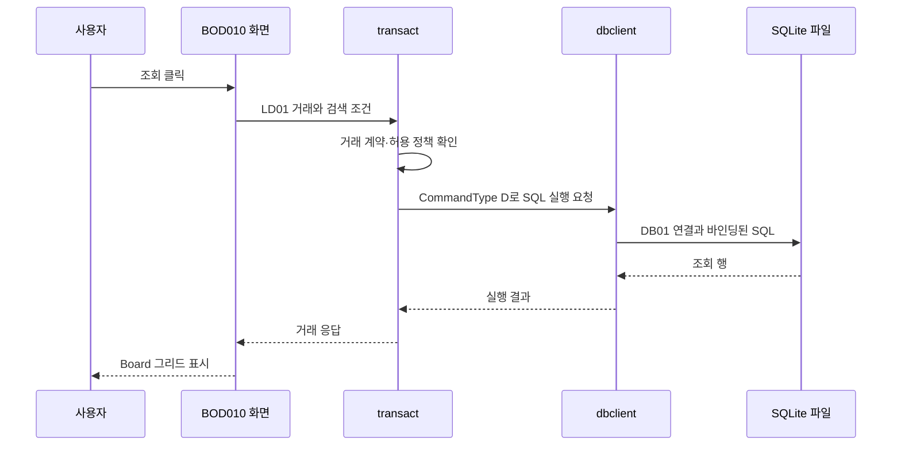

# HandStack 퍼스트북

SQLite로 시작하는 업무 웹 애플리케이션 개발

이 책은 HandStack 배포본을 실행하고, SQLite에 저장한 게시글을 화면에서 조회·등록·수정·삭제하는 과정을 안내합니다. 완성된 예제를 먼저 실행한 뒤 화면, 거래 계약, SQL 계약을 읽고 작은 변경을 적용합니다. 마지막에는 같은 구조로 요구사항을 구현하고 결과를 직접 확인합니다.

C#이나 서버 프레임워크 개발 경험은 필요 없습니다. 아래 다섯 가지를 할 수 있으면 시작할 수 있습니다.

- HTML `form`과 `input`, `select`를 작성하고, JavaScript로 입력값을 읽을 수 있습니다.
- JavaScript의 객체, 함수, 콜백(나중에 호출되는 함수)을 읽을 수 있습니다.
- SQL의 `SELECT`, `INSERT`, `UPDATE`, `DELETE`와 `WHERE`를 작성할 수 있습니다.
- 명령 프롬프트(`cmd`)에서 폴더를 이동하고 명령을 실행할 수 있습니다.
- 브라우저 개발자 도구(`F12`)를 열 수 있습니다. 쓰는 방법은 2.5절에서 안내합니다.

서버 함수(11장)는 기본 게시판을 마친 뒤 읽는 확장 주제입니다.

## 읽기 전에

이 책은 게시판 한 기능을 화면 → 거래 계약 → SQL 계약 → DB 순서로 따라가며 완성합니다.

| 장 | 하는 일 | 주로 보는 파일·도구 |
|---|---|---|
| 1~2 | HandStack이 줄여 주는 일을 알아보고 서버를 실행합니다 | 명령 프롬프트, 브라우저 |
| 3~4 | 완성된 게시판을 쓰고, 요청이 지나가는 길과 파일 배치를 이해합니다 | `BOD010` 네 파일 |
| 5 | SQLite 파일과 `Board` 테이블을 준비합니다 | DB 편집기, `module.json` |
| 6~8 | 화면, 거래 계약, SQL 계약을 읽고 조회 조건을 바꿉니다 | `BOD010` |
| 9~10 | 등록·상세·수정·삭제를 확인하고 트랜잭션을 이해합니다 | `BOD011`, `BOD012` |
| 11~12 | 서버 함수를 읽고, 오류를 진단하고, 백업합니다 | `CSF020`, 로그 |
| 13 | 처음부터 끝까지 점검하고 확장 과제를 풉니다 | 전체 |

- **직접 확인**: 읽은 내용을 손으로 확인하는 작은 과제입니다. 건너뛰면 다음 장에서 막히기 쉽습니다.
- **완료 조건**: 다음 장으로 넘어가기 전에 스스로 점검하는 기준입니다.
- “발췌”라고 적힌 코드는 설명용 조각입니다. 파일 전체는 부록 A에 있습니다.
- 막히면 12장의 증상표에서 가장 가까운 항목부터 확인합니다.

## 이 책의 기준

- 작성 기준일: 2026-11-17. 저장소의 공개 문서와 로컬 HandStack 소스 `38d5794c` 체크아웃의 파일 내용을 대조했습니다. 배포본이 다르면 함께 제공된 설정과 예제를 먼저 확인하세요.
- 실습 환경: Windows와 명령 프롬프트, 별도로 구성한 HandStack 배포본, SQLite DB 파일. macOS·Linux의 구성 명령은 기존 설치 문서로 연결합니다.
- 예제: 애플리케이션 `HDS`, 프로젝트 `BOD`, 목록 `BOD010`, 등록 `BOD011`, 상세·수정·삭제 `BOD012`.
- 설명과 완성 코드는 이 문서 안에 제공합니다. 부록 코드는 기존 게시판 원본을 바탕으로 하며 변경 사항은 부록 앞에 표시합니다. 실행에는 HandStack 배포본의 라이브러리·컨트롤·설정도 필요합니다.
- 이 파일은 저장소 루트에서 읽는 독립 Markdown 문서입니다. 기존 문서로 이동하는 링크는 이 저장소 기준의 상대 경로입니다.

> **검증 범위**: 수록한 SQL은 별도 임시 SQLite DB에서 실행해 확인했습니다. 부록의 파일은 HandStack 소스와 대조하고 구문을 검사했습니다. 그러나 HandStack 서버와 브라우저에서 화면을 직접 실행해 확인하지는 않았습니다. 화면 확인 절차는 독자가 실습 환경에서 수행할 절차입니다. 근거는 부록 C에 있습니다.

## 목차

1. [HandStack으로 무엇을 만드는가](#chapter-01)
2. [개발 환경 준비와 서버 실행](#chapter-02)
3. [게시판을 먼저 실행하기](#chapter-03)
4. [프로젝트와 요청 흐름 이해하기](#chapter-04)
5. [SQLite와 Board 테이블 준비하기](#chapter-05)
6. [HTML과 JavaScript로 화면 구성하기](#chapter-06)
7. [화면과 서버를 거래 계약으로 연결하기](#chapter-07)
8. [SQL 계약과 검색 조건 작성하기](#chapter-08)
9. [게시글 등록하기](#chapter-09)
10. [게시글 조회·수정·삭제하기](#chapter-10)
11. [서버 함수가 필요한 경우](#chapter-11)
12. [오류 진단과 운영 기초](#chapter-12)
13. [종합 실습과 완료 점검](#chapter-13)
- [부록 A. 게시판 완성 파일](#appendix-a)
- [부록 B. 용어와 문서 찾기](#appendix-b)
- [부록 C. 참고 자료와 확인 근거](#appendix-c)

<a id="chapter-01"></a>

## 1. HandStack으로 무엇을 만드는가

### 1.1 반복되는 업무 개발

게시판, 고객 목록, 주문 관리 화면은 업무 내용이 다르지만 공통 작업이 많습니다. 사용자가 조건을 입력하면 서버가 데이터를 조회하고, 결과를 표나 입력 폼에 표시합니다. 저장할 때는 값을 검증하고 데이터베이스를 변경합니다.

각 화면에서 통신·연결·SQL 실행·결과 바인딩을 새로 구현하면 기능이 늘어날수록 같은 문제를 반복해서 해결하게 됩니다. HandStack은 이런 작업을 모듈과 계약으로 나누고, 개발자가 화면과 업무 규칙을 작성하도록 구성합니다.

| 개발할 것 | 직접 구성하는 일반적인 방법 | 이 책에서 사용하는 HandStack 방식 |
|---|---|---|
| 화면 표시 | HTML과 이벤트 처리 코드 작성 | HTML·JS와 `syn` 컨트롤 사용 |
| 서버 호출 | 요청 API와 응답 처리 규약 작성 | 화면 거래 설정과 transact 계약 연결 |
| DB 접근 | 연결·명령·매개변수·결과 처리 작성 | dbclient의 데이터 원본과 SQL 계약 작성 |
| 복잡한 처리 | 서버 코드에 업무 로직 작성 | 필요할 때 function 계약과 함수 작성 |

계약 파일이 추가되므로 첫 화면의 파일 수가 적지는 않습니다. 대신 여러 화면이 같은 연결 규칙을 따릅니다. 제목 검색을 바꿀 때는 SQL을, 화면 배치를 바꿀 때는 HTML을, 서버 호출 입출력을 바꿀 때는 거래 연결을 찾아갈 수 있습니다.

### 1.2 알아둘 구성 요소

| 이름 | 이 책에서의 역할 |
|---|---|
| `ack` | HTTP 요청을 받고 HandStack 모듈을 실행하는 서버 |
| `wwwroot` | 화면과 웹 자원을 제공하는 모듈 |
| `syn` | 화면 로딩, 이벤트, 컨트롤, 거래 호출 등을 지원하는 클라이언트 라이브러리 |
| `transact` | 거래 계약을 확인하고 실행 모듈로 요청을 전달하는 모듈 |
| `dbclient` | SQL 계약을 읽고 DB에 명령을 실행하는 모듈 |
| `function` | SQL 이외의 서버 로직을 실행하는 모듈 |
| SQLite | 파일에 데이터를 저장하는 DB 엔진 |

모듈 이름 `dbclient`와 업무 프로젝트 이름 `BOD`는 다른 구분입니다. `BOD` 업무의 SQL을 `dbclient` 모듈이 실행합니다.

### 1.3 이 책에서 만들 결과

게시판은 분류·제목·기간으로 목록을 검색하고, 선택한 글의 상세 내용을 열며, 새 글 등록과 수정·삭제를 지원합니다. 로그인과 사용자별 권한, 첨부파일 저장소 구축, 다중 사용자 운영은 기본 실습에 포함하지 않습니다. HTML 편집기는 배포본에 포함된 자원을 사용하며 처음에는 이미지 업로드 없이 텍스트로 확인합니다.

**직접 확인**: “제목 검색을 추가하려면 어디를 바꿀까?”라는 질문에 지금은 “입력 화면과 SQL, 그 사이의 전달 값”이라고 답할 수 있으면 됩니다. 구체적인 연결은 6~8장에서 확인합니다.

### 1.4 같은 기능을 두 방식으로 만든다면

“제목으로 게시글 검색” 하나를 만드는 단계를 나란히 놓아 봅니다. 왼쪽은 HandStack 없이 웹 화면과 서버, DB를 직접 연결하는 일반적인 방법입니다.

| 단계 | 직접 구현할 때 | HandStack에서 |
|---|---|---|
| 1. 입력 수집 | 입력값을 읽어 요청 본문을 만드는 코드 | 입력 요소에 `syn-datafield`, `belongID` 지정 |
| 2. 서버 호출 | 주소·요청 형식·오류 처리를 정하고 작성 | `syn.$w.transactionAction('LD01')` |
| 3. 서버 진입 | 주소별 라우팅과 입력 검증 코드 | 거래 JSON에 서비스 `LD01` 등록 |
| 4. DB 실행 | 연결 생성, SQL 실행, 값 바인딩, 자원 해제 코드 | XML에 SQL과 `<param>` 선언 |
| 5. 결과 표시 | 응답을 순회하며 표에 채우는 코드 | 화면 `outputs`와 `syn_grid` 연결 |

직접 구현은 자유롭지만 화면마다 1~5단계를 되풀이하고 구현 방식이 사람마다 달라지기 쉽습니다. HandStack은 파일 수가 늘어나는 대신 단계마다 고칠 파일이 정해져 있습니다. 반대로 식별자를 틀리거나 파일을 잘못된 위치에 두면 연결이 끊기므로, 끊긴 곳을 찾는 방법을 12장에서 연습합니다.

**직접 확인**: “작성자 검색 조건 추가”에서 파일을 고쳐야 하는 단계를 위 표에서 고르세요. 1단계(입력 항목)와 4단계(SQL 매개변수·조건)입니다. 3단계의 거래 계약은 이 예제에서 입력 필드를 고정하지 않으므로 바꾸지 않아도 되는데, 이유는 7장에서 확인합니다. 실제 구현은 13장 과제입니다.

더 읽기: [HandStack 시작하기](docs/startup/개요.mdx), [요청 흐름 이해](docs/tutorial/handstack-기초개념/요청흐름-이해.mdx).

<a id="chapter-02"></a>

## 2. 개발 환경 준비와 서버 실행

### 2.1 실습용 디렉터리 정하기

운영 환경이나 이미 개발 중인 프로젝트를 사용하지 않습니다. 이 책은 배포본의 기본 경로를 `C:/handstack-firstbook/handstack`으로 정합니다. 아래 경로가 이미 있다면 데이터와 용도를 먼저 확인하고 다른 빈 경로를 사용하세요.

이 책을 보관하는 문서 저장소와 서버를 실행할 배포본 디렉터리는 서로 다릅니다. 이 문서 저장소에서 `npm run start`를 실행하면 문서 사이트가 시작되며, 게시판 서버가 시작되는 것은 아닙니다.

대조한 `ack` 소스의 대상 프레임워크가 `net10.0`이므로 .NET SDK 10을 준비합니다. Node.js는 20.12.2 이상이 필요하고, 설치 스크립트는 24 LTS를 설치하도록 안내합니다. 최소 버전을 만족해도 모든 모듈과의 호환까지 보장되지는 않으므로, 배포본의 설치 안내를 우선합니다.

명령 프롬프트에서 설치 상태를 확인합니다. 시작 메뉴에서 `cmd`를 검색해 엽니다.

```bat
dotnet --list-sdks
node --version
npm --version
curl --version
```

SDK 목록에 필요한 10.0 계열이 표시되는지, Node.js와 npm 명령이 실행되는지 확인하세요. Git은 소스를 복제할 때 필요하며 배포본 실행만 한다면 필수는 아닙니다. 설치 화면과 OS별 명령은 [필수 프로그램 설치하기](docs/startup/install/필수-프로그램-설치하기.mdx)를 따릅니다.

### 2.2 배포본 구성하기

1. [HandStack 릴리스](https://github.com/handstack77/handstack/releases/latest)에서 자신의 OS·CPU에 맞는 배포본을 받습니다. 릴리스 설명의 요구사항도 읽습니다.
2. 압축을 풀고 `app`, `modules`, `install.bat`이 있는 디렉터리를 찾습니다.
3. 그 디렉터리가 이 책의 `C:/handstack-firstbook/handstack`에 해당하도록 경로를 맞춥니다.

> 구성 스크립트는 .NET이나 Node.js를 설치하거나 기존 버전을 올릴 수 있습니다. 다른 프로젝트를 개발하는 PC라면 실행 전에 배포본의 안내를 읽으세요. `--check-only`는 자동 설치만 건너뛰며, 파일을 전혀 바꾸지 않는 시험 실행(dry-run)이 아닙니다.

```bat
cd /d C:\handstack-firstbook\handstack
install.bat
```

누락된 도구, 다운로드 실패, 권한 오류가 있으면 먼저 해결합니다. 성공 메시지가 나왔다고 다음 단계의 HTTP 응답까지 확인된 것은 아닙니다.

### 2.3 ack 실행하기

```bat
cd /d C:\handstack-firstbook\handstack\app
ack.exe
```

서버 터미널을 유지한 채 브라우저에서 `http://localhost:8421/checkip`을 엽니다. 포트를 바꿨다면 서버 로그의 주소를 사용합니다. 응답이 표시되면 호스트가 기동한 것입니다. 아직 SQLite 연결과 게시판 거래까지 확인한 것은 아닙니다.

다른 프로그램이 포트를 사용한다면 해당 프로그램을 임의로 종료하지 말고 서버 로그와 포트 설정을 확인합니다. 서버를 종료할 때는 실행한 터미널에서 `Ctrl+C`를 사용하고 종료 메시지를 기다립니다.

### 2.4 DB 편집 도구 준비하기

SQLite 파일을 열고 SQL을 실행할 수 있는 편집기 또는 SQLite CLI를 준비합니다. DB 서버 서비스나 별도의 DB 계정은 필요하지 않습니다. GUI 편집기의 “새 데이터베이스” 기능으로 임의의 파일을 먼저 만들지 말고 5장에서 서버의 연결 파일부터 확인합니다.

### 2.5 브라우저 개발자 도구 열기

이 책은 요청과 오류를 개발자 도구로 확인합니다. Chrome이나 Edge에서 `F12`(또는 `Ctrl+Shift+I`)를 누르면 열립니다.

| 탭 | 이 책에서 쓰는 곳 |
|---|---|
| Console | JavaScript 오류와 자원(스크립트·스타일) 로드 실패 |
| Network | 조회·저장 때 서버로 나간 요청과 돌아온 응답. 팝업이 닫혀도 기록을 남기려면 `Preserve log`를 켭니다 |
| Elements | 입력 요소의 `id`와 속성 |

**직접 확인**: 개발자 도구의 Network 탭을 연 채 `http://localhost:8421/checkip`을 새로고침하세요. `checkip` 요청의 Status가 `200`이고 Response에 응답 내용이 보이면 준비가 끝났습니다.

**완료 조건**: `ack` 실행 터미널과 `/checkip` 응답을 확인했고, 실습 경로를 기록했습니다. macOS·Linux에서는 [설치 안내](docs/startup/install/필수-프로그램-설치하기.mdx)의 해당 OS 절을 사용하고 이후 경로 표기를 환경에 맞게 바꿉니다.

<a id="chapter-03"></a>

## 3. 게시판을 먼저 실행하기

### 3.1 목록 화면 열기

브라우저에서 `http://localhost:8421/view/BOD/BOD010.html`을 엽니다. 제목·분류·입력기간·정렬 조건과 목록이 표시되는지 확인합니다.

404라면 배포본에 예제가 포함됐는지, 서버의 화면 경로 설정과 실제 파일 배치를 확인합니다. 예제가 없다면 4장의 경로 규칙에 따라 부록 A의 파일을 배치합니다. `.html`을 파일 탐색기에서 직접 열어 `file://`로 실행하면 서버의 자원·거래 흐름을 확인할 수 없습니다.

### 3.2 데이터 준비 방법 선택하기

이미 글이 보인다면 초기화하지 않습니다. 빈 실습 DB라면 5장의 DDL과 INSERT를 직접 실행하는 방법을 권장합니다. 화면의 초기화 버튼을 사용할 수도 있지만 그 동작은 다음과 같습니다.

> **데이터 삭제 주의**: `게시판 Board 테이블 초기화`는 기존 `Board` 행을 모두 삭제하고 `sqlite_sequence`의 Board 순번도 초기화합니다. 대상 DB01이 실습 파일인지 확인한 뒤에만 실행하세요. 원본 예제는 여러 날짜의 데이터를 넣으며, 부록 A의 축약 초기화 코드는 세 건을 넣습니다.

### 3.3 조회 조건 바꾸기

1. 제목을 비우고 분류를 `전체`로 선택합니다.
2. 입력기간에 데이터의 작성일이 포함되도록 설정합니다.
3. `조회`를 누릅니다. 분류·제목·작성자·게시일자가 있는 행이 나타나는지 확인합니다.
4. 분류를 `강좌`로 바꾸고 다시 조회합니다. 표시된 행의 분류를 확인합니다.
5. 존재하지 않는 제목을 검색합니다. 오류 없이 빈 목록이 나오면 정상적인 검색 결과입니다.

처음부터 빈 목록만 보인다면 정상 조회인지 판단할 자료가 부족합니다. 5장에서 확실한 데이터를 넣은 뒤 브라우저 Network의 거래 응답과 서버 로그를 함께 확인하세요.

### 3.4 읽을 파일 찾기

지금 실행한 화면은 네 파일로 나뉩니다.

| 파일 | 이 파일에서 찾을 것 |
|---|---|
| `BOD010.html` | 조회 버튼, 검색 조건, 결과 그리드 |
| `BOD010.js` | `LD01` 설정과 조회 버튼 이벤트 |
| `BOD010.json` | `LD01`의 서버 입력·출력과 실행 모듈 |
| `BOD010.xml` | 실제 목록 SQL과 매개변수 |

**직접 확인**: 제목 입력란에 한 단어를 입력하고 조회한 뒤, 그 단어가 거래 요청에 포함되는지 Network에서 찾아보세요. 전체 요청을 공개할 때는 인증 정보나 개인정보를 제거합니다.

더 읽기: [게시판 첫 조회](docs/tutorial/첫-조회.mdx).

<a id="chapter-04"></a>

## 4. 프로젝트와 요청 흐름 이해하기

### 4.1 한 번의 조회가 지나가는 길



브라우저는 SQLite 파일을 직접 열지 않습니다. DB 파일과 연결 문자열은 서버에서 관리합니다. HTML에 SQL을 적거나 DB 연결 문자열을 JavaScript에 넣는 방법은 이 흐름에 해당하지 않습니다.

### 4.2 식별자를 맞추기

| 값 | 구분 | 맞춰야 하는 위치 |
|---|---|---|
| `HDS` | 애플리케이션 | 경로, JSON의 ApplicationID, XML의 application |
| `BOD` | 업무 프로젝트 | 경로, JSON의 ProjectID, XML의 project |
| `BOD010` | 화면·거래 | 파일명, JS 화면 객체, JSON·XML 거래 ID |
| `LD01` | 목록 서비스 | JS 거래 이름, JSON ServiceID, XML statement id |
| `DB01` | 데이터 원본 | XML datasource, dbclient의 DataSourceID |

이 예제의 서비스 ID는 `LD01` 목록, `ID01` 등록, `GD01` 상세, `UD01` 수정, `DD01` 삭제, `ZD01` 초기화입니다. 이름은 읽기 쉽게 붙인 관례일 뿐, 실제로 어떤 모듈이 실행하는지는 서버 거래 계약의 `CommandType`이 정합니다. `LD`로 시작한다는 이유만으로 SQL이 실행되는 것은 아닙니다.

### 4.3 파일 배치와 실제 편집 위치

기본 계약 경로를 사용하는 배포본은 다음 구조를 사용합니다.

```text
handstack/
├─ app/                         # 여기에서 ack 실행
├─ modules/
│  ├─ wwwroot/module.json
│  ├─ transact/module.json
│  └─ dbclient/module.json
├─ contracts/
│  ├─ wwwroot/HDS/BOD/           # BOD010~012.html, .js
│  ├─ transact/HDS/BOD/          # BOD010~012.json
│  └─ dbclient/HDS/BOD/          # BOD010~012.xml
└─ sqlite/HDS/dbclient/HDS.db    # 현재 예제 DB01의 파일 위치
```

이 구조가 모든 배포본의 편집 경로를 보장하는 것은 아닙니다. 모듈 내부 Contracts에서 공용 contracts로 복사하는 구성이 있을 수 있습니다. 먼저 실제 `module.json`의 계약 경로·복사 설정을 확인합니다. 서버를 다시 시작하거나 배포할 때 원본으로 덮어써지는 실행 파일만 수정하면 변경이 사라질 수 있습니다.

로컬 소스의 예제 원본은 `2.Modules/wwwroot/Contracts` 아래에 있습니다. 소스 폴더를 편집하는 경우와 이미 압축을 푼 배포본을 편집하는 경우를 구분하세요. 부록 파일은 **확인한 실제 계약 경로**에 저장합니다. 기존 예제 파일이 있다면 교체 전에 실습 디렉터리 밖의 백업 위치에 복사해 둡니다. 서버가 감시하는 계약 폴더 안에 같은 ID의 백업 계약을 추가하지 않습니다.

### 4.4 확장자 이해하기

이 책은 기본 게시판의 `.json`·`.xml`을 사용합니다. IDE에서 생성한 transact의 `.txn`, dbclient의 `.dbc`도 각각 JSON·XML 내부 형식을 사용합니다. 같은 ID로 두 확장자의 파일을 동시에 추가하거나 책을 따라 한다는 이유로 기존 확장자를 일괄 변경하지 않습니다.

### 4.5 변경 이력 남기기

한 기능을 바꾸려면 HTML·JS·JSON·XML 여러 파일을 고칩니다. 잘못 고쳤을 때 돌아갈 수 있도록 4.3에서 확인한 **contracts 폴더**만 Git 저장소로 만들어 두면 편합니다. 배포본 전체를 저장소로 만들지 않습니다. 이미 Git 저장소 안에 있는 폴더라면 새로 만들지 않고 기존 저장소를 씁니다.

```bat
cd /d <4.3에서 확인한 contracts 폴더>
git init
git add .
git commit -m "실습 시작 상태"
```

파일을 고친 뒤 `git diff`로 바뀐 줄을 확인하고, 원래대로 되돌릴 때는 `git restore -- <파일 경로>`를 사용합니다. 되돌리기는 저장하지 않은 변경을 지우므로 파일 이름을 확인한 뒤 실행하세요. `.db` 파일은 contracts 밖의 `sqlite` 폴더에 있어 이 저장소에 들어가지 않습니다.

**직접 확인**: 실제 `BOD010.xml`에서 datasource를 읽고, 어떤 `module.json`의 어떤 DataSource가 연결되는지 설명해 보세요.

대표 규칙: [식별자와 파일 경로](docs/reference/식별자와-파일-경로.mdx).

<a id="chapter-05"></a>

## 5. SQLite와 Board 테이블 준비하기

### 5.1 SQLite는 서버가 사용하는 파일이다

SQLite에서는 파일 경로가 연결 대상입니다. 같은 이름의 `HDS.db`라도 다른 폴더에 있으면 다른 DB입니다. 존재하지 않는 경로로 연결했을 때 새 빈 파일이 생기면 “연결은 됐지만 테이블이 없다”는 현상이 나타날 수 있습니다.

실행 중인 서버가 사용하는 `modules/dbclient/module.json`에서 `ModuleConfig.DataSource`를 찾습니다. 다음은 현재 원본의 DB01 항목입니다. **전체 module.json이 아니라 DataSource 배열 안의 객체 하나**입니다. 기존 항목과 설정을 보존하고 중복 DB01을 추가하지 마세요.

```json
{
  "ApplicationID": "HDS",
  "ProjectID": "*",
  "DataSourceID": "DB01",
  "DataProvider": "SQLite",
  "ConnectionString": "URI=file:../sqlite/HDS/dbclient/HDS.db;Journal Mode=Off;BinaryGUID=False;DateTimeFormat=Ticks;Version=3;",
  "IsEncryption": "N",
  "Comment": "SQLite 기본 데이터베이스"
}
```

`DataSource`는 dbclient의 연결 목록입니다. function 모듈의 데이터 원본 설정과 혼동하지 않습니다. 위 값은 소스 예제의 설명이며 운영 권장 설정이 아닙니다. 특히 `Journal Mode=Off`는 내구성과 장애 복구를 고려한 운영 설정으로 그대로 채택하지 않습니다.

`app`에서 실행하는 기본 구조라면 `../sqlite/HDS/dbclient/HDS.db`는 기본 경로 아래 `sqlite/HDS/dbclient/HDS.db`에 해당합니다. 서비스·IDE·다른 작업 디렉터리에서 실행했다면 서버가 실제로 해석하는 절대 경로를 별도로 확인합니다.

명령 프롬프트에서 예상 파일을 확인하는 예입니다. 명령은 DB 내용을 바꾸지 않습니다. `dir` 결과의 `Directory of` 줄이 파일의 전체 경로입니다.

```bat
cd /d C:\handstack-firstbook\handstack\app
dir ..\sqlite\HDS\dbclient\HDS.db
```

파일이 없다면 임의의 다른 파일을 열지 말고 연결 문자열과 상위 폴더·쓰기 권한을 확인합니다. SQL 편집기는 확인한 같은 파일을 엽니다. 편집기에서 다음 명령으로 열린 파일도 확인할 수 있습니다.

```sql
PRAGMA database_list;
```

### 5.2 데이터 모델 정하기

| 컬럼 | 저장 타입 | 역할 |
|---|---|---|
| ID | INTEGER | 자동 증가 기본키 |
| Category | TEXT | 정보·강좌·소식 등의 분류 |
| Title | TEXT | 제목 |
| Content | TEXT | 본문, 예제에서는 편집기의 HTML 문자열 |
| Author | TEXT | 작성자 |
| DatePosted | TEXT | `YYYY-MM-DD HH:mm:ss` 형태의 작성 일시 |

다음 DDL은 기존 예제와 호환되는 설계입니다. ID 이외에 `NOT NULL` 제약이 없으므로 필수 입력은 테이블 자체가 보장하지 않습니다. 화면의 표시와 DB 제약, 서버 검증은 별개입니다.

> 아래 작업은 실습 DB를 변경합니다. 기존 Board 테이블이 있다면 먼저 스키마를 비교하세요. `IF NOT EXISTS`는 이미 있는 테이블의 구조를 수정하지 않습니다.

```sql
CREATE TABLE IF NOT EXISTS Board (
    ID INTEGER PRIMARY KEY AUTOINCREMENT,
    Category TEXT,
    Title TEXT,
    Content TEXT,
    Author TEXT,
    DatePosted TEXT
);
```

### 5.3 초기 데이터 넣기

다음 SQL은 기존 행을 지우지 않고 세 건을 추가합니다. 반복 실행하면 데이터가 추가되므로 최초 준비 때 한 번 실행합니다. 편집기가 수동 커밋 모드라면 커밋한 뒤 서버에서 조회하세요.

```sql
INSERT INTO Board (Category, Title, Content, Author, DatePosted)
VALUES ('정보', 'HandStack 시작하기', '첫 번째 실습 글입니다.', '개발자',
        datetime('now', 'localtime', '-1 day'));

INSERT INTO Board (Category, Title, Content, Author, DatePosted)
VALUES ('강좌', 'SQLite 조회 실습', '분류 조건을 바꾸어 조회하세요.', '개발자',
        datetime('now', 'localtime', '-1 day'));

INSERT INTO Board (Category, Title, Content, Author, DatePosted)
VALUES ('소식', '게시판 준비 완료', '등록과 수정도 확인해 보세요.', '개발자',
        datetime('now', 'localtime', '-2 day'));
```

### 5.4 SQL로 먼저 조회하기

```sql
SELECT ID, Category, Title, Author, DatePosted
FROM Board
ORDER BY ID DESC;
```

비어 있던 DB라면 세 행이 보이고 `SQLite 조회 실습`의 분류는 `강좌`여야 합니다. 이미 데이터가 있었다면 전체 행 수 대신 방금 넣은 제목을 확인합니다.

```sql
SELECT ID, Category, Title
FROM Board
WHERE Category = '강좌' AND Title LIKE '%SQLite%';
```

화면에서 같은 분류와 제목으로 조회해 결과를 비교합니다. SQL 편집기에서만 글이 보인다면 두 프로그램의 DB 파일, 커밋 여부, 화면 입력기간을 확인합니다.

### 5.5 SQLite를 사용할 때 기억할 점

날짜는 이 예제에서 TEXT입니다. 동일한 형식으로 저장해야 문자열 비교가 날짜 순서와 맞습니다. 날짜에 지역별 표현을 섞지 않습니다. 예제의 `localtime`은 DB를 실행하는 서버의 현지 시간을 사용합니다.

SQLite는 파일에 쓰므로 파일과 디렉터리의 권한이 중요합니다. 편집기의 쓰기 트랜잭션을 오래 열어 두면 서버 쓰기와 충돌할 수 있습니다. 다중 사용자 서비스에서의 쓰기 동시성·백업·장애 복구는 별도 운영 설계가 필요합니다.

**완료 조건**: 서버 DB01과 SQL 편집기가 같은 파일을 사용하며, 테이블과 준비한 행을 직접 조회했습니다.

대표 설계: [Board 테이블 설계](docs/tutorial/도메인모델과-데이터베이스/게시판-board-테이블-설계.mdx), [DB 연결과 검증](docs/tutorial/도메인모델과-데이터베이스/데이터베이스-연결과-검증.mdx).

<a id="chapter-06"></a>

## 6. HTML과 JavaScript로 화면 구성하기

### 6.1 HTML은 항목을, JS는 동작을 정의한다

부록 A의 `BOD010.html`과 `BOD010.js`를 나란히 엽니다. HTML에는 검색 입력과 그리드가 있고, JS에는 거래 설정·화면 초기화·버튼 이벤트·팝업 메서드가 있습니다.

다음은 완성 HTML에서 발췌한 입력과 버튼입니다. 전체 화면을 이 조각만으로 교체하지 않습니다.

```html
<form autocomplete="off" id="form1" syn-datafield="MainForm">
    <input id="txtTitle" syn-datafield="Title"
           syn-options="{editType: 'text', belongID: ['LD01']}"
           type="text" class="form-control" maxlengthB="256">
    <button type="button" id="btnSearch" syn-events="['click']">조회</button>
</form>
```

| 속성 | 의미 |
|---|---|
| `id="txtTitle"` | DOM 요소와 컨트롤을 찾는 ID |
| `syn-datafield="Title"` | 거래에 연결하는 데이터 필드 이름 |
| `syn-datafield="MainForm"` | 입력을 묶는 폼의 데이터 이름 |
| `belongID: ['LD01']` | 이 입력을 포함할 거래 |
| `syn-events="['click']"` | 화면 스크립트로 연결할 이벤트 |

DOM ID와 거래 필드 이름을 같은 값으로 만들 필요는 없습니다. SQL의 `@Title`로 전달될 값은 이 예제에서 `Title` 데이터 필드로 수집됩니다.

### 6.2 화면 객체 읽기

다음은 `BOD010.js`의 조회 부분만 남긴 설명용 발췌입니다. 팝업과 초기화 동작까지 필요한 경우 부록의 전체 파일을 사용합니다.

```js
let $BOD010 = {
    transaction: {
        LD01: {
            inputs: [{ type: 'Row', dataFieldID: 'MainForm' }],
            outputs: [{ type: 'Grid', dataFieldID: 'Board' }]
        }
    },
    hook: {
        pageLoad() {
            syn.$w.transactionAction('LD01');
        }
    },
    event: {
        btnSearch_click() {
            syn.$w.transactionAction('LD01');
        }
    }
};
```

`pageLoad`에서 첫 조회를 실행합니다. 버튼 클릭은 `btnSearch_click`으로 연결되고 같은 거래를 실행합니다. `MainForm`은 입력 한 행, `Board`는 결과 목록을 받는 그리드입니다. `transactionAction`은 조회 행을 반환하는 Promise가 아니므로 `await` 결과로 목록을 얻는 코드를 작성하지 않습니다.

### 6.3 컨트롤과 로더

원본 목록은 `syn_grid`, 날짜 입력은 `syn_datepicker`, 본문은 `syn_htmleditor`를 사용합니다. 화면의 마지막에는 다음 로더가 있습니다.

```html
<script src="/js/syn.loader.js"></script>
```

일반적인 정적 HTML에 태그만 복사한다고 이 컨트롤이 동작하지는 않습니다. HandStack의 자원과 초기화 과정이 필요합니다. 원본의 숨겨진 body는 로더 초기화와 함께 동작하므로 화면이 비어 보이면 먼저 자원 404와 Console 오류를 확인합니다.

### 6.4 작은 변경 실습

`BOD010.html`에서 조회 버튼에 표시되는 문구를 `게시글 조회`로 바꿉니다. `id`, `syn-events`, 데이터 필드는 바꾸지 않습니다. 새로고침 후 문구가 바뀌고 조회가 계속되는지 확인합니다.

다음으로 제목 검색 입력의 화면 배치를 바꿔 보세요. 배치를 바꿔도 필드 이름과 거래 연결을 유지하면 검색은 같아야 합니다. 변경이 보이지 않으면 브라우저 캐시보다 먼저 실제 편집 파일과 서버의 계약 경로가 같은지 확인합니다.

더 읽기: [화면 개발 시작하기](docs/startup/learning/화면-개발-시작하기.mdx), [거래 호출](docs/reference/거래-호출.mdx).

<a id="chapter-07"></a>

## 7. 화면과 서버를 거래 계약으로 연결하기

### 7.1 화면 설정과 서버 계약의 차이

JS의 `transaction.LD01`은 어떤 화면 입력을 수집하고 결과를 어디에 넣을지 정합니다. 서버의 `BOD010.json`은 어떤 서비스가 존재하며 어떤 모듈로 실행할지 정합니다. 한쪽만 만들면 연결이 완성되지 않습니다.

다음은 `BOD010.json`의 `Services` 안에 있는 목록 서비스 발췌입니다.

```json
{
  "ServiceID": "LD01",
  "Authorize": false,
  "ReturnType": "Json",
  "CommandType": "D",
  "TransactionScope": false,
  "Inputs": [
    {
      "ModelID": "Dynamic",
      "Fields": [],
      "TestValues": [],
      "DefaultValues": [],
      "Type": "Row",
      "BaseFieldMappings": [],
      "ParameterHandling": "Rejected"
    }
  ],
  "Outputs": [
    { "ModelID": "Dynamic", "Fields": [], "Type": "Grid" }
  ]
}
```

`CommandType: "D"`는 dbclient 실행을 뜻합니다. `ModelID: "Dynamic"`은 필드를 미리 고정하지 않고 화면이 보내는 필드를 그대로 받겠다는 표시입니다. 그래서 이 계약만으로는 필드 이름의 오타나 누락이 걸러지지 않습니다. 서버 설정의 `IsAllowDynamicRequest`(동적 거래 요청 허용)와는 다른 개념입니다. 필드를 엄격히 검증하는 방법은 9.6절에서 다룹니다.

### 7.2 입출력 맞추기

입출력의 `Type`은 데이터의 모양을 뜻합니다.

| Type | 모양 | 이 예제에서 |
|---|---|---|
| `Row` | 입력 한 건(항목 이름과 값의 묶음) | 검색 조건, 저장할 글 한 건 |
| `Form` | 결과 한 건을 입력칸에 채움 | 상세 조회 결과 |
| `Grid` | 결과 여러 건을 표로 채움 | 게시글 목록 |

| 동작 | 화면 JS 입력 | 서버 입력 | 서버 출력 | 화면 JS 출력 |
|---|---|---|---|---|
| 목록 `LD01` | MainForm / Row | Row | Grid | Board / Grid |
| 등록 `ID01` | MainForm / Row | Row | 없음 | 없음 |
| 상세 `GD01` | MainForm / Row | Row | Form | MainForm / Form |
| 수정 `UD01` | MainForm / Row | Row | 없음 | 없음 |
| 삭제 `DD01` | MainForm / Row | Row | 없음 | 없음 |

화면의 출력 이름 `Board`는 HTML의 `syn-datafield="Board"`와 JS의 `dataFieldID: 'Board'`가 서로 맞으면 됩니다. 서버 JSON의 `ModelID`에 같은 이름을 쓰지 않습니다. 맞춰야 하는 것은 개수입니다. 화면의 `outputs` 개수와 서버가 돌려주는 결과 집합 수가 같아야 하고, 입력 `Row`는 정확히 한 건이어야 합니다. 수정·삭제처럼 출력이 없는 거래도 DB는 변경됩니다.

### 7.3 서버 정책과 계약 반영

`Authorize: false`는 로그인 없이 실습하기 위한 예제 값입니다. 이 속성만으로 익명 호출이 허용되는 것은 아니며, transact의 요청 허용 목록·공개 거래·라우팅 설정도 함께 맞아야 합니다. 오류를 피하려고 예제의 와일드카드 허용 정책을 운영 서버에 복사하지 마세요.

`AccessScreenID`를 생략한 서비스는 자기 거래와 같은 이름의 화면만 호출할 수 있습니다. 이 책의 서비스는 모두 같은 이름의 화면(`BOD010`의 `LD01`은 `BOD010` 화면)이 호출하므로 생략해도 됩니다. 다른 화면이나 팝업이 호출하게 바꾸면 그 화면 ID를 `AccessScreenID`에 추가해야 하며, 빠지면 `요청 가능화면 거래 매핑 정보 확인 필요` 오류가 나옵니다.

파일을 저장한 뒤 서버의 계약 감시·복사 설정을 확인합니다. 반영이 불명확하면 실습 서버를 정상 종료하고 다시 시작한 후 로드 오류를 확인합니다. 모든 설정이 즉시 재적재된다고 가정하지 않습니다.

### 7.4 결과 확인과 실패 확인

1. 서버 JSON에 `LD01`이 존재하는지 확인합니다.
2. SQL XML에 같은 거래 ID와 `LD01`이 있는지 확인합니다.
3. 조회 후 Network에서 거래 응답과 오류 정보를 확인합니다.
4. 출력 행의 값이 화면의 Board 그리드에 나타나는지 확인합니다.

HTTP 상태 `200`은 서버가 응답했다는 뜻일 뿐 업무 성공은 아닙니다. 응답 본문의 `acknowledge`와 `message` 값으로 거래의 성공·실패를 판단합니다(진단 순서는 [진단 도구와 계층](docs/tutorial/테스트와-디버깅/진단-도구와-계층.mdx)). 모든 실패가 JS의 `callback`으로 전달되는 것도 아니므로 Console, Network, 서버 로그를 함께 봅니다.

**직접 확인**: 서버 출력 Grid와 화면 출력 Board가 어떻게 연결되는지 표의 한 행을 따라 설명해 보세요.

대표 문서: [거래 호출](docs/reference/거래-호출.mdx), [거래 계약 명세](docs/reference/거래-계약-명세.mdx), [transact 설정](docs/reference/api/modules/transact.mdx).

<a id="chapter-08"></a>

## 8. SQL 계약과 검색 조건 작성하기

### 8.1 mapper와 statement

`BOD010.xml`에는 application·project·transaction·datasource를 가진 header와, SQL을 담는 statement가 있습니다. 부록 A의 전체 파일을 열고 `LD01`을 찾습니다.

다음은 매개변수 선언 형태를 설명하는 **statement 내부 발췌**입니다.

```xml
<param id="@Title" type="String" length="-1" value="" />
```

화면의 `Title`, XML의 `@Title`, SQL의 `@Title`이 같은 값을 연결합니다. SQL 편집기에서 `@Title`이 있는 SQL을 실행할 때도 매개변수 값을 지정해야 합니다. 값을 지정하지 않고 실행한 결과를 화면 조회와 비교하지 마세요.

### 8.2 조건을 한 개씩 이해하기

아래는 부록의 목록 SQL과 같은 의미로 조건 부분을 단순화한 **SQL 학습용 발췌**입니다. 전체 XML을 대체하는 파일은 아닙니다.

```sql
SELECT B.ID, B.Category, B.Title, B.Author, B.DatePosted,
       '확인' AS EditPost
FROM Board B
WHERE B.DatePosted BETWEEN @StartDate AND (@EndDate || ' 23:59:59')
  AND (@Category = '' OR B.Category = @Category)
  AND (@Title = '' OR B.Title LIKE ('%' || @Title || '%'))
ORDER BY B.ID DESC;
```

- `StartDate`, `EndDate`에는 `YYYY-MM-DD` 문자열을 전달합니다.
- 분류가 빈 문자열이면 전체 분류를, 값이 있으면 그 분류를 조회합니다.
- 제목이 비어 있으면 전체 제목을, 값이 있으면 포함 검색을 합니다.
- `EditPost`는 DB 컬럼이 아니라 상세 버튼을 표시하기 위해 결과에 추가한 값입니다.

빈 문자열과 NULL은 같지 않습니다. 이 실습은 화면이 빈 검색 값을 빈 문자열로 전달하는 계약을 따릅니다. 외부 호출자가 NULL을 보낼 때의 정책까지 자동으로 보장하지 않습니다.

날짜와 시간 사이의 공백을 포함해 저장 형식과 비교 문자열을 맞춥니다. 부록에서는 원본의 종료일 연결 문자열에 공백을 명시했습니다. 이 조건은 초 단위 문자열을 사용하는 실습 범위입니다. 더 높은 정밀도의 날짜나 다른 시간대를 쓰는 업무는 별도 설계가 필요합니다.

### 8.3 값을 바인딩하기

제목 값을 SQL 문자열에 이어 붙여 SQL 문장을 만들지 않습니다. `@Title`에 값을 바인딩하고 SQL은 고정합니다. 작은따옴표가 포함된 제목도 데이터로 전달되어야 합니다.

`LIKE`의 `%`와 `_`는 검색 패턴입니다. 바인딩을 사용한다고 이 문자가 일반 문자 검색으로 바뀌지는 않습니다. 이 예제는 패턴 검색을 허용하며, 문자 그대로 검색하는 요구사항은 별도의 이스케이프 규칙이 필요합니다.

### 8.4 정렬 선택과 동적 SQL

부록의 SQL은 `OrderBy`와 `Sequence`를 CASE 식으로 처리합니다. 허용한 컬럼은 `ID`, `Category`, `Title`, `Author`이며 방향은 `ASC`와 `DESC`입니다. 사용자 입력을 그대로 `ORDER BY` SQL 조각으로 삽입하지 않습니다.

고정 CASE만으로 해결되는 이 게시판은 XML 조건 태그가 필수가 아닙니다. 조건에 따라 SQL 구조가 달라질 때 dbclient의 `<if>` 같은 동적 SQL 기능을 검토합니다. CDATA 안에 조건 태그를 쓰면 XML 태그가 아니라 SQL 텍스트가 되므로, 기능의 정확한 배치와 구문은 [단독 검증과 동적 SQL](docs/tutorial/dbclient-SQL계약/단독-검증과-동적SQL.mdx)과 연결된 예제를 먼저 확인합니다.

### 8.5 검색 확인표

| 입력 | 기대 결과 |
|---|---|
| 분류·제목 빈 값, 데이터 포함 기간 | 모든 준비 데이터 |
| 분류 `강좌` | 강좌 데이터만 |
| 제목 `SQLite` | 해당 단어가 있는 제목만 |
| 존재하지 않는 제목 | 빈 목록, SQL 오류 없음 |
| 작성일이 기간 밖인 데이터 | 결과에 없음 |
| ID 역순 → 정순 | ID의 표시 순서 변경 |

**직접 변경**: 목록 SQL의 마지막 정렬을 학습용 발췌처럼 `ORDER BY B.ID DESC`로 잠시 고정합니다. 조회가 되는지 확인한 뒤 원래 CASE 정렬로 복원합니다. 고정한 동안 화면의 정렬 선택이 반영되지 않는 이유를 설명해 보세요.

대표 문서: [dbclient](docs/reference/api/modules/dbclient.mdx).

<a id="chapter-09"></a>

## 9. 게시글 등록하기

### 9.1 등록 파일 배치하기

부록 A의 `BOD011.html`, `BOD011.js`, `BOD011.json`, `BOD011.xml`을 실제 계약 경로에 배치합니다. 기존 완성 예제를 이용한다면 네 파일을 읽고 다음 연결을 확인합니다.

| 화면 데이터 | SQL 매개변수 | 저장 컬럼 |
|---|---|---|
| Category | @Category | Category |
| Title | @Title | Title |
| Content | @Content | Content |
| Author | @Author | Author |
| CreateDate | @CreateDate | DatePosted 생성에 사용 |

화면은 작성일을 `CreateDate`로 받고, SQL은 날짜와 현재 시각을 합쳐 `DatePosted`에 저장합니다. ID는 SQLite가 생성하므로 등록 입력에 포함하지 않습니다.

### 9.2 입력 검증 후 거래 실행하기

원본의 저장 이벤트는 제목·작성일·작성자·본문이 비었는지 확인하고 `ID01`을 호출합니다. 다음은 제목 검증 부분의 발췌입니다.

```js
var title = syn.$l.get('txtTitle').value.trim();
if (title == '') {
    syn.$w.alert('제목을 입력하세요');
    return false;
}
syn.$w.transactionAction('ID01');
```

부록의 실제 이벤트에는 다른 필드 검증도 있으므로 이 발췌로 전체 이벤트를 교체하지 않습니다. 위 코드는 공백만 있는 제목을 막지만 trim한 값을 입력 요소에 다시 저장하지는 않습니다. 앞뒤 공백을 정규화해 저장하려면 별도의 요구사항으로 처리해야 합니다.

화면 검증은 사용자 입력을 돕습니다. 외부 요청이나 변조 요청을 막는 서버 검증을 대체하지 않습니다. 본문도 HTML 문자열이므로 빈 HTML, 허용 태그, 안전한 표시 정책은 운영 전 추가 검토가 필요합니다.

### 9.3 INSERT 읽기

다음은 완성 SQL 계약의 INSERT를 줄여 쓴 설명용 발췌입니다.

```sql
INSERT INTO Board (Category, Title, Content, Author, DatePosted)
VALUES (
    @Category, @Title, @Content, @Author,
    CASE WHEN @CreateDate = ''
         THEN datetime('now', 'localtime')
         ELSE (@CreateDate || ' ' || strftime('%H:%M:%S', 'now', 'localtime'))
    END
);
```

화면은 작성일을 필수로 검사하지만 SQL에는 빈 작성일에 대한 분기도 있습니다. 두 계층의 코드가 같은 검증을 모두 수행하는 것은 아닙니다. SQL에 분기가 있다고 잘못된 날짜까지 검증되는 것도 아닙니다.

### 9.4 팝업과 목록 갱신

등록 화면은 목록의 `신규 게시글 작성` 버튼으로 엽니다. 정상 응답 후 등록 화면이 `syn.$n.emit('response')`를 보내면 목록의 팝업 처리기가 창을 닫고 `LD01`을 다시 실행합니다. 등록 화면을 주소창에서 직접 열면 부모 창과 채널이 없어 같은 목록 갱신을 관찰할 수 없습니다.

작성일이 목록의 검색 기간 안에 있는지 확인하세요. 저장 성공 후에도 현재 제목·분류 필터에 맞지 않으면 새 글이 보이지 않을 수 있습니다.

### 9.5 직접 확인

1. 제목을 비워 저장합니다. 경고가 표시되고 INSERT 요청이 나가지 않아야 합니다.
2. 제목에 `퍼스트북 등록 확인`, 본문·작성자를 넣고 오늘 날짜로 저장합니다.
3. 목록 필터를 비우고 해당 제목을 조회합니다.
4. SQL 편집기에서 다음 조회로 같은 행을 확인합니다.

```sql
SELECT ID, Title, Author, DatePosted
FROM Board
WHERE Title = '퍼스트북 등록 확인'
ORDER BY ID DESC;
```

저장 버튼을 두 번 누르면 중복 등록될 수 있는 예제입니다. 요청 중 버튼 비활성화나 서버의 중복 방지는 구현되어 있지 않습니다.

### 9.6 서버에서도 검증하기

화면 검증은 개발자 도구나 직접 호출로 우회할 수 있습니다. 규칙을 한 겹 더 두는 위치를 정리하면 다음과 같습니다.

| 위치 | 막을 수 있는 것 | 이 책의 상태 |
|---|---|---|
| 화면 JS | 사용자의 입력 실수 | BOD011·BOD012에 있음 |
| 거래 계약의 명시 모델(`ModelID`, `Models`) | 모델에 없는 필드 | 사용하지 않음(`Dynamic`) |
| 거래 계약 `ValidateRules` | 응답 결과가 조건을 만족하지 않는 경우 | 사용하지 않음 |
| DB 제약(`NOT NULL`, `CHECK`) | 어떤 경로로 호출해도 빈 제목 저장 | `Board`에 없음 |
| SQL·서버 함수 | 업무 규칙(중복, 권한 등) | 필요할 때 추가 |

명시 모델과 `ValidateRules`의 형식은 [거래 계약 명세](docs/reference/거래-계약-명세.mdx)를 봅니다. `ValidateRules`는 입력이 아니라 응답 데이터를 검사한다는 점에 주의하세요.

DB 제약이 어떻게 동작하는지는 연습용 테이블로 확인합니다. `Board`는 건드리지 않습니다. 편집기에서 **한 줄씩** 실행하세요(오류가 나면 이후 문장이 실행되지 않는 편집기가 많습니다).

```sql
CREATE TABLE IF NOT EXISTS BoardCheck (
    ID INTEGER PRIMARY KEY AUTOINCREMENT,
    Title TEXT NOT NULL CHECK (length(trim(Title)) > 0),
    Author TEXT NOT NULL
);

INSERT INTO BoardCheck (Title, Author) VALUES ('   ', '개발자');   -- CHECK constraint failed
INSERT INTO BoardCheck (Title, Author) VALUES (NULL, '개발자');    -- NOT NULL constraint failed
INSERT INTO BoardCheck (Title, Author) VALUES ('정상', '개발자');  -- 성공

DROP TABLE BoardCheck;
```

앞의 두 문장은 오류로 거부되고 세 번째만 저장됩니다. 화면 검증을 우회해도 DB가 같은 규칙을 지켜 줍니다. SQLite는 이미 만든 `Board` 테이블에 제약을 바로 추가할 수 없어, 기존 테이블에 적용하려면 새 테이블을 만들고 데이터를 옮기는 마이그레이션이 필요합니다. 이 책에서는 하지 않습니다.

<a id="chapter-10"></a>

## 10. 게시글 조회·수정·삭제하기

### 10.1 선택한 ID로 상세 조회하기

목록의 상세 버튼은 선택한 행에서 ID와 제목을 읽어 BOD012 팝업으로 전달합니다. 부록의 `BOD012.js`는 채널의 `request`를 받아 숨겨진 `txtID`에 값을 넣고 `GD01`을 호출합니다.

다음은 상세 HTML의 숨겨진 ID 입력입니다.

```html
<input type="hidden" id="txtID" syn-datafield="ID"
       syn-options="{belongID: ['GD01', 'UD01', 'DD01']}">
```

ID는 상세 조회·수정·삭제에 모두 필요합니다. 숨겨진 입력이라고 신뢰할 수 있는 값은 아니며, 사용자별 접근 권한은 서버가 확인해야 합니다. 기본 예제에는 사용자별 게시글 소유권 검증이 없습니다.

`GD01`의 서버 출력은 Form이고 JS 출력은 MainForm입니다. 조회한 Title·Category·Content·Author가 입력 폼에 매핑됩니다. BOD012를 주소창에서 단독으로 열면 ID 수신이 없어 자동 상세 조회가 진행되지 않습니다. 목록에서 열어 확인하세요.

### 10.2 수정하기

수정은 `UD01`을 사용합니다. 다음은 SQL 본문이며 전체 계약은 부록에 있습니다.

```sql
UPDATE Board
SET Category = @Category,
    Title = @Title,
    Content = @Content,
    Author = @Author
WHERE ID = @ID;
```

`WHERE ID = @ID`가 수정 대상을 제한합니다. 이 절을 빼면 모든 행이 변경됩니다. 작성 일시와 ID는 이 수정 SQL에서 변경하지 않습니다.

1. 등록한 글의 상세를 엽니다.
2. 제목 끝에 `수정`을 붙이고 저장합니다.
3. 목록과 SQL 조회에서 같은 ID의 제목이 바뀌었는지 확인합니다.
4. 다른 글의 제목은 그대로인지 확인합니다.

### 10.3 삭제하기

> 아래 삭제는 선택한 글을 실제로 지웁니다. 자신이 만든 실습 행의 ID와 제목을 확인한 뒤 실행하세요. 이 예제는 휴지통이나 삭제 복구 기능을 제공하지 않습니다.

`BOD012.js`는 삭제 확인 창에서 `Yes`를 선택한 경우에만 `DD01`을 호출합니다.

```sql
DELETE FROM Board
WHERE ID = @ID;
```

먼저 삭제를 취소해 행이 유지되는지 확인합니다. 다시 삭제를 승인하고 목록과 DB에서 그 ID가 사라졌는지 확인합니다. 삭제 후 자동 증가 ID가 이전 번호를 재사용해야 한다고 가정하지 않습니다.

### 10.4 성공 메시지와 변경 행 수

예제의 수정·삭제는 오류 유무로 응답을 처리하며 변경된 행을 화면에 별도 출력하지 않습니다. 없는 ID를 수정·삭제하면 SQL 오류 없이 변경 행 수 0일 수 있습니다. 성공 알림만으로 대상 행의 존재와 변경을 보장하지 않습니다.

### 10.5 여러 SQL을 하나로 묶는 트랜잭션

지금까지 서비스 하나는 SQL 하나를 실행했습니다. “글 저장과 이력 저장”처럼 둘 이상을 함께 처리할 때는 모두 성공하거나 모두 취소되어야 합니다. 이 묶음이 트랜잭션입니다. SQLite 편집기에서 `ROLLBACK`으로 취소하는 과정을 확인합니다. 마지막에 취소하므로 데이터는 그대로입니다. `ID = 1`인 행이 없으면 존재하는 ID로 바꾸세요.

```sql
BEGIN;
UPDATE Board SET Title = Title || '(임시)' WHERE ID = 1;
SELECT ID, Title FROM Board WHERE ID = 1;   -- 제목 끝에 '(임시)'가 보임
ROLLBACK;
SELECT ID, Title FROM Board WHERE ID = 1;   -- 원래 제목
```

> `BEGIN` 뒤에 `COMMIT`이나 `ROLLBACK`을 실행하지 않으면 쓰기 잠금이 남아 서버의 저장이 `database is locked`로 실패할 수 있습니다. 실습이 끝나면 반드시 둘 중 하나를 실행하세요.

HandStack에서는 서비스의 `TransactionScope`가 이 묶음을 정합니다. `true`이면 한 요청의 모든 statement를 하나의 DB 트랜잭션으로 묶습니다. 여러 `seq`를 저장·삭제하는 서비스는 `true`, 조회는 `false`로 둡니다. 이 책의 BOD010~012는 서비스마다 SQL이 하나라 `false`입니다. 순차 거래(`CommandType: "S"`)는 전체가 하나의 DB 트랜잭션으로 롤백된다고 가정하지 마세요. 자세한 내용은 [거래 계약 명세](docs/reference/거래-계약-명세.mdx)를 봅니다.

**완료 조건**: 등록한 행의 ID를 유지한 채 수정했고, 삭제 취소와 승인 결과를 각각 확인했습니다. 수정·삭제 뒤에는 대상 행과 다른 행을 함께 비교하는 습관을 들이세요. `ROLLBACK` 전후의 제목이 어떻게 달랐는지 설명할 수 있습니다.

<a id="chapter-11"></a>

## 11. 서버 함수가 필요한 경우

### 11.1 SQL과 함수의 역할 나누기

목록 조회와 단일 INSERT는 dbclient 계약으로 처리했습니다. 외부 서비스 연동, 파일 처리, 복잡한 계산처럼 SQL만으로 끝나지 않는 로직은 function을 검토합니다. 기존 CRUD를 모두 함수로 옮겨야 하는 것은 아닙니다.

| 작업 | 이 책의 선택 |
|---|---|
| 분류·제목 검색, 단일 행 저장 | dbclient SQL 계약 |
| 단순한 입력 누락 안내 | 화면 검증, 운영에서는 서버 검증도 추가 |
| 외부 알림 호출, 여러 규칙의 조합 | 서버 함수 검토 |

이 장은 **기존 함수 예제의 연결을 읽는 확장 학습**입니다. 기본 게시판에 외부 알림이나 새 함수 파일을 추가하지 않으며, 외부 서비스의 계정·비용·전송도 필요하지 않습니다.

### 11.2 실제 함수 계약 읽기

대조한 소스의 예제는 `2.Modules/function/Contracts/function/HDS/TST/CSF020.xml`입니다. 배포본에 포함되어 있다면 실제 function 계약 경로의 대응 파일을 읽습니다. 파일이 없는 배포본에 존재한다고 가정하지 않습니다.

다음은 해당 파일의 식별자와 입력 부분을 설명하기 위한 발췌입니다. 생략한 script와 나머지 header가 있어 단독 실행 파일은 아닙니다.

```xml
<header>
    <application>HDS</application>
    <project>TST</project>
    <transaction>CSF020</transaction>
    <datasource>FN01</datasource>
    <language>csharp</language>
</header>
<commands>
    <command id="GF01" seq="0" use="Y" timeout="0" desc="Form 반환 거래 함수">
        <param id="ServerDate" type="String" length="0" value="NULL" required="false" />
        <param id="ServerName" type="String" length="0" value="NULL" required="false" />
    </command>
</commands>
```

script 안에는 `CSF020` 클래스의 `GF01` 메서드가 있고, 두 매개변수로 `FunctionResult` 문자열을 만드는 코드가 있습니다. 이 메서드는 별도로 선언된 featureSQL의 `L01`을 호출하지 않습니다. featureSQL이 파일에 있다는 이유로 모든 SQL이 자동 실행된다고 생각하지 마세요.

여기서 `FN01`은 함수 설정의 데이터 원본 연결이며 게시판의 dbclient `DB01`을 그대로 뜻하지 않습니다. 함수의 실제 반환 DataTable과 command 출력 메타가 맞는지도 함께 점검해야 합니다. 예제 주석만 보고 출력 컬럼을 추측하지 않습니다.

### 11.3 CommandType만 바꾸면 연결되는가

함수 실행 거래에는 `CommandType: "F"`를 사용합니다. 하지만 기존 BOD011의 D만 F로 바꾼다고 임의의 함수에 연결되지는 않습니다. 기본 연결 기준은 애플리케이션·프로젝트·거래·함수 식별자입니다.

위 예제를 기본 식별자로 호출하려면 서버 거래와 라우팅이 `HDS / TST / CSF020 / GF01` 함수에 연결되어야 하며, 입력과 반환 테이블에 맞는 출력도 구성해야 합니다. 다른 계약을 실행하도록 연결할 때는 실제 지원하는 매핑을 확인합니다. 함수 파일 이름만 다르게 만들어 놓고 자동으로 찾을 것이라고 가정하지 않습니다.

폴더형 함수는 `featureMain.*`와 `featureMeta.json` 등을 사용합니다. 단일 파일 `.fnc`는 헤더·스크립트·명령 등을 함께 담으며, 현재 로더는 대응하는 XML 형식도 지원합니다. 사용하는 배포본의 형식을 따릅니다.

**직접 확인**: 원본의 header·command·클래스·메서드에서 같은 식별자를 찾아 적어 보세요. 이 장의 완료 기준은 연결을 설명하는 것이며 함수 호출 성공을 의미하지 않습니다.

정확한 형식과 실행 규칙: [function 모듈](docs/reference/api/modules/function.mdx).

<a id="chapter-12"></a>

## 12. 오류 진단과 운영 기초

### 12.1 실패한 계층부터 좁히기

| 증상 | 먼저 확인할 것 | 다음 행동 |
|---|---|---|
| `/checkip`에 연결할 수 없음 | ack 종료, 실행 주소·포트, 시작 로그 | 호스트 기동부터 복구 |
| 게시판 404 | 화면 파일, wwwroot 경로·복사 설정 | 실제 배포 경로 확인 |
| 화면이 비어 있음 | 로더·컨트롤 자원 404, Console | 첫 초기화 오류부터 해결 |
| 클릭해도 요청이 없음 | 버튼 ID·syn-events·이벤트 이름 | JS 로딩과 이벤트 확인 |
| 거래를 찾지 못함 | HDS·BOD·거래 ID·ServiceID | JSON·XML·서버 계약 경로 대조 |
| `거래 매핑 정보 확인 필요` | 화면 `transaction` 키와 JSON `ServiceID`의 오타·대소문자 | 이름을 한 글자씩 대조 |
| `요청 가능화면 거래 매핑 정보 확인 필요` | 호출한 화면이 서비스의 `AccessScreenID`에 없음 | 7.3절의 화면 ID 확인 |
| `거래 입력 항목이 계약과 동일한지 확인 필요` | 명시 `Inputs` 개수와 요청이 다르거나 `Row`가 한 건이 아님 | 화면 `inputs`와 JSON `Inputs` 비교 |
| 요청이 거절됨 | transact 정책·인증·공개 거래 범위 | 허용 정책의 의도를 확인 |
| `no such table: Board` | DB01 실제 파일과 테이블 | 같은 파일에서 DDL 확인 |
| SQL 도구에서만 데이터가 보임 | 다른 DB 파일, 미커밋, 화면 조건 | 절대 경로와 기간 비교 |
| `database is locked` | 편집기의 열린 쓰기 트랜잭션 | 커밋·롤백 후 재시도 |
| 읽기 전용 또는 파일 열기 실패 | 파일·디렉터리 권한과 경로 | 서버 실행 계정 기준 확인 |
| 저장 후 새 글이 안 보임 | 저장 응답, 현재 검색 조건, 채널 응답 | DB 행부터 확인 |
| 수정했는데 계속 이전 코드 | 실제 계약 원본·복사·감시 설정 | 실습 서버 재시작 후 로드 확인 |

### 12.2 한 번에 하나씩 바꾸기

오류를 재현할 입력과 시간, 화면 ID, 서비스 ID, 응답의 correlationID가 있다면 함께 기록합니다. 다음 순서로 확인합니다.

1. SQL 편집기에서 같은 DB의 대상 행을 확인합니다.
2. 브라우저 Network에서 요청 값과 응답 오류를 확인합니다.
3. Console의 첫 오류와 서버의 대응 로그를 확인합니다.
4. 식별자나 매개변수 한 가지를 고치고 같은 입력으로 재시도합니다.

SQL 오류를 고치려고 화면·계약·연결 설정을 한꺼번에 바꾸면 원인을 추적하기 어렵습니다. HTTP 통신 성공, 거래 성공, 데이터 변경 확인을 각각 구분하세요. 위 표의 오류 문구 전체는 [거래 오류 메시지](docs/reference/거래-오류-메시지.mdx)에서 찾을 수 있습니다.

### 12.3 로그로 원인 찾기

화면에서 원인이 보이지 않으면 로그를 읽습니다. 로그는 세 곳에 있습니다.

| 위치 | 담긴 것 | 보는 방법 |
|---|---|---|
| 브라우저 Console·Network | 화면 오류, 요청·응답 | `F12` |
| `ack` 실행 터미널과 모듈 로그 | 계약 로드 오류, SQL 오류, 예외 스택 | 서버 터미널 출력. 로그 파일 위치는 배포본 설정 |
| `logger` 모듈의 거래 로그 | 거래 요청·응답 기록 | [logger](docs/reference/api/modules/logger.mdx) 설정 |

확인 순서는 Network의 요청 → 응답의 `acknowledge`·`message` → 서버 로그입니다. 요청이 서버에 가지 않았다면 서버 로그를 뒤지기 전에 화면 이벤트 연결을 먼저 봅니다. 같은 요청의 브라우저 기록과 서버 로그를 이어 줄 열쇠로 응답의 `correlationID`를 메모해 두세요.

거래 로그는 세 곳의 설정이 함께 정합니다. 화면 옵션 `transactionLog`(기본 `'Y'`), 계약 서비스의 `TransactionLog`(기본 `false`), 서버의 `IsTransactionLogging`입니다. `logger`는 `DataSource`에 등록된 애플리케이션의 로그만 저장하며 SQLite를 기본으로 쓸 수 있습니다. 로그에는 요청·응답 전문과 예외가 담기므로, 로그를 공유하거나 이슈에 붙일 때는 개인정보와 비밀 값을 지웁니다.

**직접 확인**: 오류를 일부러 만들어 로그에서 찾아 봅니다. 4.5절의 변경 이력을 만든 실습 환경에서만 진행하세요.

1. `BOD010.json`에서 `LD01`의 `ServiceID` 값만 `LD99`로 바꾸고 저장합니다. 7.3절처럼 서버가 계약을 다시 읽도록 합니다.
2. 목록 화면에서 `조회`를 누릅니다. 화면 JS는 여전히 `LD01`을 호출합니다.
3. Network의 응답 `message`와 서버 터미널 로그에서 `거래 매핑 정보 확인 필요` 계열의 문구를 찾습니다. 문구의 `'…'` 자리에 호출한 `LD01`이 표시되는지 확인합니다.
4. `git restore -- <BOD010.json 경로>`로 원래대로 되돌리고 서버가 다시 읽도록 한 뒤 조회가 되는지 확인합니다.

화면 JS의 서비스 이름을 바꾸면 거래 설정이 없어 요청이 서버로 나가지 않습니다. 오류를 어느 계층에서 볼 수 있는지가 다르므로 이 방법은 쓰지 않습니다.

### 12.4 SQLite 백업의 기본

실습에서 단순 파일 복사로 백업하려면 먼저 ack와 DB 편집기를 정상 종료해 연결을 닫습니다. WAL 등 다른 저널 모드를 사용하는 파일을 실행 중에 `.db` 하나만 복사하면 일관된 백업이라고 보장할 수 없습니다. 운영 중 백업에는 사용하는 SQLite 공급자·도구의 백업 기능과 복구 절차를 확인합니다.

다음은 **서버와 편집기를 종료한 뒤** 명령 프롬프트에서 실행하는 실습용 예입니다. 새 백업 디렉터리를 사용하고 같은 이름의 기존 백업이 있으면 복사를 중단합니다. 백업할 때마다 파일 이름의 번호(`HDS-backup-1.db`)를 바꾸세요.

```bat
set "BOOK_DB=C:\handstack-firstbook\handstack\sqlite\HDS\dbclient\HDS.db"
set "BOOK_BACKUP_DIR=C:\handstack-firstbook\backups"
set "BOOK_BACKUP=%BOOK_BACKUP_DIR%\HDS-backup-1.db"
if not exist "%BOOK_BACKUP_DIR%" mkdir "%BOOK_BACKUP_DIR%"
if exist "%BOOK_BACKUP%" (echo 같은 이름의 백업 파일이 이미 있습니다. 번호를 바꾸세요.) else (copy "%BOOK_DB%" "%BOOK_BACKUP%" && dir "%BOOK_BACKUP%")
```

파일이 있다는 것만으로 복구가 검증된 것은 아닙니다. 별도 실습 경로에서 백업을 열어 Board와 중요한 행이 조회되는지 확인합니다. 기존 실행 DB에 바로 덮어써서 복구를 시험하지 않습니다.

### 12.5 운영으로 넘어가기 전에

이 예제는 학습용 공개 거래와 단순 데이터 모델을 사용합니다. 운영에서는 인증·권한·서버 검증, HTML 본문의 안전한 표시, TLS·비밀 정보, 감사 기록, 백업 복구와 동시 쓰기 부하를 검토해야 합니다. 초기화 거래 ZD01과 화면 버튼을 공개 서비스에 그대로 노출하지 않습니다.

배포는 로컬에서 성공한 파일만 복사하면 끝나는 작업이 아닙니다. 모듈 버전, 계약, DB 구조, 자원과 환경 설정을 맞추고 재시작·회귀 확인·복구 방법을 준비합니다. 이 책의 실습을 끝냈다는 이유로 운영 배포가 검증된 것은 아닙니다.

더 읽기: [문제 해결](docs/guides/문제-해결.mdx), [비밀정보 관리](docs/tutorial/환경설정과-보안/비밀정보-관리.mdx).

<a id="chapter-13"></a>

## 13. 종합 실습과 완료 점검

### 13.1 게시판을 한 번에 설명하기

부록 A의 완성 파일을 실습 환경의 실제 계약 경로에 배치하거나 기존 예제와 비교합니다. DB01을 확인하고 Board와 데이터를 준비한 뒤 아래 시나리오를 순서대로 수행합니다. 기존 파일 교체는 4장의 백업·경로 확인 절차를 먼저 따릅니다.

| 순서 | 수행할 작업 | 합격 기준 |
|---|---|---|
| 1 | ack 기동과 `/checkip` 확인 | 응답과 서버 기동 로그 확인 |
| 2 | DB 파일과 준비 데이터 확인 | 서버 연결과 편집기의 절대 경로 일치 |
| 3 | 전체·분류·제목 조회 | 8장의 검색 표 충족 |
| 4 | 빈 제목으로 등록 시도 | 안내 표시, 등록 요청 없음 |
| 5 | 오늘 날짜의 글 등록 | DB와 목록에서 같은 행 확인 |
| 6 | 상세 열기 | 선택한 ID의 본문·작성자 표시 |
| 7 | 제목 수정 | 같은 ID만 변경, 다른 행 유지 |
| 8 | 삭제 취소 | 대상 행 유지 |
| 9 | 삭제 승인 | 대상 ID만 제거 |
| 10 | 서버 정상 재시작 | 남은 글 재조회, 영속 저장 확인 |

화면 로딩만 완료하거나 SQL만 성공했다면 이 표 전체를 통과한 것은 아닙니다. 아직 확인하지 않은 항목은 미확인으로 기록합니다.

### 13.2 직접 구현 과제: 분류 추가

정보·강좌·소식에 `질문` 분류를 추가합니다. DB 스키마는 변경하지 않습니다.

1. 목록 BOD010의 분류 select에 값과 표시 문구가 모두 `질문`인 option을 추가합니다.
2. 등록 BOD011과 편집 BOD012의 분류 select에도 같은 option을 추가합니다.
3. 등록 화면에서 질문 글을 저장합니다.
4. 목록에서 질문만 검색하고 상세를 엽니다.
5. 질문을 강좌로 수정하고 두 분류의 조회 결과가 바뀌는지 확인합니다.

**합격 기준**: 기존 분류와 전체 조회가 유지되고, 질문 글의 등록·검색·수정이 이어집니다. Category를 바인딩하는 기존 계약과 SQL은 그대로 사용할 수 있어야 합니다. 한 화면에만 option을 추가했을 때 어떤 동작이 불완전해지는지도 설명합니다.

### 13.3 다음 과제: 작성자 검색 설계

바로 구현하기 전에 변경 목록을 작성해 보세요. 최소한 목록의 입력 항목과 `belongID`, SQL의 매개변수 선언과 조건, 서버 입력 모델 정책을 확인해야 합니다. 목록에 표시하는 `Author` 컬럼이 있다는 사실만으로 작성자 검색이 구현되지는 않습니다.

조건이 빈 값이면 전체, 값이 있으면 포함 검색이라는 규칙과 다른 조건과의 AND 결합을 먼저 정합니다. 작성자에 작은따옴표가 있어도 SQL이 깨지지 않아야 하며 없는 작성자는 빈 결과가 나와야 합니다. 이 확장 과제는 부록 완성 코드에 포함하지 않습니다.

먼저 변경 목록을 직접 작성한 다음 아래 예시 답안과 비교하세요.

**예시 답안(변경 목록)**

| 파일 | 변경 |
|---|---|
| `BOD010.html` | 제목 입력 옆에 `syn-datafield="Author"`, `belongID: ['LD01']`인 입력 추가 |
| `BOD010.xml` | `LD01`에 `<param id="@Author" .../>` 선언과 `WHERE`의 조건 추가 |
| `BOD010.json` | 변경 없음. 입력이 `Dynamic`이라 화면이 보내는 필드를 그대로 받습니다 |
| `BOD010.js` | 변경 없음. 입력은 `MainForm` 전체를 수집합니다 |

```html
<!-- BOD010.html: 발췌. 검색 조건 행(row) 안에 같은 모양의 칸으로 추가 -->
<div class="col-sm-12 col-md-6 col-lg-3 mt-2 pl-0">
    <div class="input-group">
        <label class="w:86 col-form-label px-2">작성자</label>
        <input id="txtAuthor" syn-datafield="Author"
               syn-options="{editType: 'text', belongID: ['LD01']}"
               type="text" class="form-control" maxlengthB="256">
    </div>
</div>
```

```xml
<!-- BOD010.xml의 LD01: 발췌. 기존 Title 조건 바로 아래에 AND 조건 추가 -->
    AND CASE WHEN @Author = '' THEN @Author ELSE B.Author END LIKE ('%' || @Author || '%')
<!-- 기존 param 목록에 추가 -->
<param id="@Author" type="String" length="-1" value="" />
```

SQL 조건은 임시 SQLite DB에서 확인했습니다. 빈 값은 전체 행, `홍`은 `홍길동`만, `O'Brien`과 없는 이름은 빈 결과였습니다. 화면과 HandStack을 거친 동작은 확인하지 않았으므로 직접 검증하세요. 한 줄에 칸이 네 개이므로 다섯 번째 칸은 다음 줄로 내려갑니다.

### 13.4 다음 과제: 페이징 설계

게시글이 수백 건이 되면 한 번에 모두 조회하기 어렵습니다. 한 번에 N건씩 나누어 가져오는 방식이 페이징이며, 크게 두 가지 방법이 있습니다.

| 방법 | 설명 |
|---|---|
| 목록 컨트롤의 자체 페이징 | 모두 가져온 뒤 화면에서 나눠 보여 줍니다. `GridList`의 `paging` 옵션은 [GridList 문서](docs/startup/learning/uicontrols/grid-list.mdx)를 봅니다 |
| SQL 페이징 | 필요한 구간만 DB에서 가져옵니다. 건수가 많을 때 적합합니다 |

SQL 페이징의 핵심은 `LIMIT`와 `OFFSET`입니다. 아래는 부록 `LD01`의 정렬 부분을 단순하게 바꾼 설명용 발췌이며, 임시 SQLite DB에서 3건 중 `PageSize` 2로 1쪽은 최신 2건, 2쪽은 나머지 1건이 나오는 것을 확인했습니다.

```sql
SELECT B.ID, B.Category, B.Title, B.Author, B.DatePosted
FROM Board B
ORDER BY B.ID DESC
LIMIT @PageSize OFFSET ((@PageNo - 1) * @PageSize);

SELECT COUNT(*) AS TotalCount FROM Board;   -- 전체 쪽 수를 계산할 건수
```

구현 전에 변경 목록을 작성해 보세요.

1. 화면에 `PageNo`, `PageSize`를 담을 입력과 이전·다음 버튼이 필요한가?
2. 전체 건수를 받으려면 서비스의 출력이 하나 더 필요합니다. 7.2절의 규칙에 따르면 서버 `Outputs`와 화면 `outputs`의 개수가 모두 바뀝니다.
3. `PageNo`, `PageSize` 매개변수를 문자열로 선언해도 되는지, 숫자 타입(`Int32` 등)으로 선언해야 하는지 [dbclient](docs/reference/api/modules/dbclient.mdx) 문서에서 확인하세요. 위 SQL은 문자열 값 바인딩으로 확인했을 뿐, HandStack의 매개변수 처리를 거치지는 않았습니다.
4. 검색 조건(분류·제목·기간)이 바뀌면 `PageNo`를 1로 되돌려야 합니다. 이유를 설명해 보세요.

### 13.5 학습 완료 점검표

- [ ] 문서 사이트와 실제 HandStack 서버를 구분할 수 있습니다.
- [ ] 화면에서 SQLite까지의 요청 경로를 설명할 수 있습니다.
- [ ] 실제 편집하는 계약과 서버 DB01의 파일 경로를 알고 있습니다.
- [ ] 식별자, 서비스 ID, 데이터 필드 이름이 맞는지 확인할 수 있습니다.
- [ ] SQL을 바인딩하고 다른 행을 건드리지 않는 CRUD를 확인했습니다.
- [ ] 화면 검증, 서버 검증, DB 제약이 각각 막는 것을 설명할 수 있습니다.
- [ ] 트랜잭션이 필요한 경우와 `ROLLBACK`의 효과를 설명할 수 있습니다.
- [ ] 오류가 났을 때 Network → 응답 `message` → 서버 로그 순서로 원인을 좁힐 수 있습니다.
- [ ] 삭제·초기화의 영향과 SQLite 백업의 조건을 이해합니다.
- [ ] 실행한 검증과 미확인 사항을 구분해 기록했습니다.

<a id="appendix-a"></a>

## 부록 A. 게시판 완성 파일

다음 12개 코드 블록은 각각 **완전한 파일**입니다. 각 제목의 경로는 기본 배포 구조 기준이며 4장에서 확인한 실제 경로에 적용합니다. 빈 폴더에 이 파일만 두고 실행하는 프로젝트는 아닙니다. HandStack 배포본의 syn 자원, 그리드·편집기 컨트롤, 서버 모듈과 설정이 필요합니다.

대조한 원본은 HandStack 소스의 `2.Modules/wwwroot/Contracts`입니다. 본문에는 이해를 위한 발췌가 있지만 부록은 화면 세 개와 서버 계약을 모두 담았습니다. 라이브러리 파일이나 module.json 전체를 덮어쓰지 않습니다.

원본 대비 교육용 변경은 다음 두 가지입니다.

1. `BOD010.xml`의 ZD01 초기 데이터를 세 건으로 줄였습니다. 기존 행·순번 삭제는 그대로 포함되므로 초기화 시 데이터가 삭제됩니다.
2. LD01의 종료일과 시간 사이에 공백을 넣어 `YYYY-MM-DD HH:mm:ss` 형식으로 명시했습니다.

정렬·조회·팝업 통신·입출력은 기존 예제의 구조를 유지합니다. 원본 예제의 인증 정책·입력 검증 한계도 본문에서 설명한 대로 남아 있습니다.

### A.1. contracts/wwwroot/HDS/BOD/BOD010.html

```html
<!DOCTYPE html>
<html lang="ko">
<head>
    <meta charset="utf-8">
    <meta name="viewport" content="width=device-width, initial-scale=1.0">
</head>
<body style="visibility: hidden;">
    <form autocomplete="off" id="form1" syn-datafield="MainForm">
        <div class="page">
            <div class="page-wrapper">
                <div class="page-header mt-2 d-print-none">
                    <div class="container-fluid max-width:1600!">
                        <div class="row g-2 align-items-center">
                            <div class="col">
                                <h2 class="page-title">
                                    게시판
                                </h2>
                            </div>
                            <div class="col-auto ms-auto d-print-none">
                                <div class="btn-list">
                                    <button type="button" id="btnTruncateTable" syn-events="['click']" class="btn btn-danger">
                                        <i class="font:20 mr:4 ti ti-refresh-alert"></i>
                                        게시판 Board 테이블 초기화
                                    </button>
                                    <button type="button" id="btnNewBoard" syn-events="['click']" class="btn btn-primary">
                                        <i class="font:20 mr:4 ti ti-news"></i>
                                        신규 게시글 작성
                                    </button>
                                    <button type="button" id="btnSearch" syn-events="['click']" class="btn btn-secondary">
                                        <i class="font:20 mr:4 ti ti-search"></i>
                                        조회
                                    </button>
                                </div>
                            </div>
                        </div>
                    </div>
                </div>
                <div class="page-body mt-2">
                    <div class="container-fluid max-width:1600!">
                        <div class="card mb-4">
                            <div class="card-body p-2">
                                <div class="row mt--2">
                                    <div class="col-sm-12 col-md-6 col-lg-3 mt-2 pl-0">
                                        <div class="input-group">
                                            <label class="w:86 col-form-label px-2">제목</label>
                                            <input id="txtTitle" syn-datafield="Title" syn-options="{editType: 'text', belongID: ['LD01']}" type="text" class="form-control" maxlengthB="256">
                                        </div>
                                    </div>
                                    <div class="col-sm-12 col-md-6 col-lg-3 mt-2 pl-0">
                                        <div class="input-group">
                                            <label class="w:86 col-form-label px-2">분류</label>
                                            <select class="form-select" id="ddlCategory" syn-datafield="Category" syn-options="{toSynControl: false, belongID: ['LD01']}">
                                                <option value="" selected="">전체</option>
                                                <option value="정보">정보</option>
                                                <option value="강좌">강좌</option>
                                                <option value="소식">소식</option>
                                            </select>
                                        </div>
                                    </div>
                                    <div class="col-sm-12 col-md-6 col-lg-3 mt-2 pl-0">
                                        <div class="input-group">
                                            <label class="w:86 col-form-label px-2">입력기간</label>
                                            <syn_datepicker id="dtpStartDate" syn-datafield="StartDate" syn-options="{value: 'month:-1', useRangeSelect: true, rangeEndControlID: 'dtpEndDate', belongID: ['LD01']}"></syn_datepicker>
                                            <label class="bg-white col-form-label border-left:0! ml:1! mr:2!">~</label>
                                            <syn_datepicker id="dtpEndDate" syn-datafield="EndDate" syn-options="{value: 'now', useRangeSelect: true, rangeStartControlID: 'dtpStartDate', belongID: ['LD01']}"></syn_datepicker>
                                        </div>
                                    </div>
                                    <div class="col-sm-12 col-md-6 col-lg-3 mt-2 pl-0">
                                        <div class="input-group">
                                            <label class="w:86 col-form-label px-2">정렬순서</label>
                                            <select class="form-select" id="ddlOrderBy" syn-datafield="OrderBy" syn-options="{toSynControl: false, belongID: ['LD01']}">
                                                <option value="ID" selected="">게시글 ID</option>
                                                <option value="Category">분류</option>
                                                <option value="Title">제목</option>
                                                <option value="Author">작성자</option>
                                            </select>
                                            <select class="form-select" id="ddlSequence" syn-datafield="Sequence" syn-options="{toSynControl: false, belongID: ['LD01']}">
                                                <option value="DESC" selected="">역순</option>
                                                <option value="ASC">정순</option>
                                            </select>
                                        </div>
                                    </div>
                                </div>
                            </div>
                        </div>
                        <div class="card">
                            <div class="card-body p-2">
                                <div class="form-fieldset p-0">
                                    <syn_grid id="grdBoard" syn-datafield="Board" syn-options="{
                                    height: 420
				                    , columns: [
                                        ['ID', '게시글 ID', 100, false, 'text', false, 'center']
                                        , ['Category', '분류', 100, false, 'text', false, 'center']
                                        , ['Title', '제목', 400, false, 'text', false, 'left']
                                        , ['Author', '작성자', 100, false, 'text', true, 'center']
                                        , ['DatePosted', '게시일자', 200, false, 'text', true, 'center']
                                        , ['EditPost', '상세', 80, false, 'button', true, 'center']
				                    ]
                                    , readOnly: true
			                    }" syn-events="['afterSelectionEnd']"></syn_grid>
                                </div>
                            </div>
                        </div>
                    </div>
                </div>
            </div>
        </div>
    </form>
    <script src="/js/syn.loader.js"></script>
</body>
</html>
```

### A.2. contracts/wwwroot/HDS/BOD/BOD010.js

```js
'use strict';
let $BOD010 = {
    transaction: {
        ZD01: {
            inputs: [{ type: 'Row', dataFieldID: 'MainForm' }],
            outputs: [],
            callback: (error, responseObject, addtionalData) => {
                if ($string.isNullOrEmpty(error) == true) {
                    syn.$w.notify('success', `게시판 테이블이 초기화 되었습니다 !`);
                    syn.$w.transactionAction('LD01');
                }
            }
        },

        LD01: {
            inputs: [{ type: 'Row', dataFieldID: 'MainForm' }],
            outputs: [{ type: 'Grid', dataFieldID: 'Board' }]
        },
    },

    hook: {
        pageLoad() {
            syn.$w.transactionAction('LD01');
        }
    },

    event: {
        btnTruncateTable_click(evt) {
            var alertOptions = $object.clone(syn.$w.alertOptions);
            alertOptions.icon = 'question';
            alertOptions.buttonType = '3';
            syn.$w.alert('정말로 게시판 테이블을 초기화 하시겠습니까?', '초기화 확인', alertOptions, (result) => {
                if (result == 'Yes') {
                    syn.$w.transactionAction('ZD01');
                }
            });
        },

        btnNewBoard_click(evt) {
            $this.method.openPopup('신규 게시글', 'BOD011.html');
        },

        btnSearch_click(evt) {
            syn.$w.transactionAction('LD01');
        },

        grdBoard_cellButtonClick(elID, row, column, prop, value) {
            var gridID = 'grdBoard';
            var columnViewPost = syn.uicontrols.$grid.propToCol(gridID, 'EditPost');
            if (column == columnViewPost && row > -1) {
                $this.method.openPopup('게시글 확인 및 편집', 'BOD012.html', (elID) => {
                    let post = {
                        postID: syn.uicontrols.$grid.getDataAtCell(gridID, row, 'ID'),
                        title: syn.uicontrols.$grid.getDataAtCell(gridID, row, 'Title')
                    };

                    syn.$n.call('BOD010', 'request', post);
                });
            };
        }
    },

    method: {
        openPopup(title, src, callback) {
            let windowID = 'BOD010';
            let popupOptions = $object.clone(syn.$w.popupOptions);
            popupOptions.title = title;
            popupOptions.src = src;
            popupOptions.channelID = windowID;
            popupOptions.isModal = true;
            popupOptions.width = 800;
            popupOptions.height = 750;
            popupOptions.notifyActions.push({
                actionID: 'response',
                handler(evt, val) {
                    syn.$w.windowClose(windowID);
                    syn.$w.transactionAction('LD01');
                }
            });

            syn.$w.windowOpen(windowID, popupOptions, callback);
        }
    }
}
```

### A.3. contracts/transact/HDS/BOD/BOD010.json

```json
{
    "ApplicationID": "HDS",
    "ProjectID": "BOD",
    "TransactionID": "BOD010",
    "Comment": "게시글 목록 거래",
    "Services": [
        {
            "ServiceID": "ZD01",
            "Authorize": false,
            "ReturnType": "Json",
            "CommandType": "D",
            "TransactionScope": false,
            "Inputs": [
                {
                    "ModelID": "Dynamic",
                    "Fields": [],
                    "TestValues": [],
                    "DefaultValues": [],
                    "Type": "Row",
                    "BaseFieldMappings": [],
                    "ParameterHandling": "Rejected"
                }
            ],
            "Outputs": []
        },
        {
            "ServiceID": "LD01",
            "Authorize": false,
            "ReturnType": "Json",
            "CommandType": "D",
            "TransactionScope": false,
            "Inputs": [
                {
                    "ModelID": "Dynamic",
                    "Fields": [],
                    "TestValues": [],
                    "DefaultValues": [],
                    "Type": "Row",
                    "BaseFieldMappings": [],
                    "ParameterHandling": "Rejected"
                }
            ],
            "Outputs": [
                {
                    "ModelID": "Dynamic",
                    "Fields": [
                    ],
                    "Type": "Grid"
                }
            ]
        }
    ],
    "Models": []
}
```

### A.4. contracts/dbclient/HDS/BOD/BOD010.xml

```xml
<?xml version="1.0" encoding="UTF-8"?>
<mapper xmlns="contract.xsd">
	<header>
		<application>HDS</application>
		<project>BOD</project>
		<transaction>BOD010</transaction>
		<datasource>DB01</datasource>
		<use>Y</use>
		<desc>게시판 Board 테이블 DDL 및 게시글 조회</desc>
	</header>
	<commands>
        <statement id="ZD01" seq="0" use="Y" timeout="0" desc="Board 테이블 DDL 및 초기 데이터 입력 적용">
            <![CDATA[
CREATE TABLE IF NOT EXISTS Board (
	ID INTEGER PRIMARY KEY AUTOINCREMENT,
	Category TEXT,
	Title TEXT,
	Content TEXT,
	Author TEXT,
	DatePosted TEXT
);

DELETE FROM Board;

DELETE FROM sqlite_sequence WHERE name = 'Board';

INSERT INTO Board (Category, Title, Content, Author, DatePosted)
VALUES ('정보', 'HandStack 시작하기', '첫 번째 실습 글입니다.', '개발자', datetime('now', 'localtime', '-1 day'));
INSERT INTO Board (Category, Title, Content, Author, DatePosted)
VALUES ('강좌', 'SQLite 조회 실습', '분류 조건을 바꾸어 조회하세요.', '개발자', datetime('now', 'localtime', '-1 day'));
INSERT INTO Board (Category, Title, Content, Author, DatePosted)
VALUES ('소식', '게시판 준비 완료', '등록과 수정도 확인해 보세요.', '개발자', datetime('now', 'localtime', '-2 day'));
            ]]>
        </statement>

        <statement id="LD01" seq="0" use="Y" timeout="0" desc="분류, 기간, 제목을 기준으로 게시글 조회">
            <![CDATA[
CREATE TABLE IF NOT EXISTS Board (
	ID INTEGER PRIMARY KEY AUTOINCREMENT,
	Category TEXT,
	Title TEXT,
	Content TEXT,
	Author TEXT,
	DatePosted TEXT
);

SELECT B.ID
    , B.Category
    , B.Title
    , B.Author
    , B.DatePosted
    , '확인' AS EditPost
FROM Board B
WHERE B.DatePosted BETWEEN @StartDate AND (@EndDate || ' 23:59:59')
    AND CASE WHEN @Category = '' THEN @Category ELSE B.Category END = @Category
    AND CASE WHEN @Title = '' THEN @Title ELSE B.Title END LIKE ('%' || @Title || '%')
ORDER BY (CASE @Sequence WHEN 'ASC' THEN CASE @OrderBy
        WHEN 'ID' THEN ID
        WHEN 'Category' THEN Category
        WHEN 'Title' THEN Title
        WHEN 'Author' THEN Author END
    END) ASC
    , (CASE @Sequence WHEN 'DESC' THEN CASE @OrderBy
        WHEN 'ID' THEN ID
        WHEN 'Category' THEN Category
        WHEN 'Title' THEN Title
        WHEN 'Author' THEN Author END
    END) DESC;
			]]>
            <param id="@Category" type="String" length="-1" value="" />
            <param id="@Title" type="String" length="-1" value="" />
            <param id="@StartDate" type="String" length="-1" value="" />
            <param id="@EndDate" type="String" length="-1" value="" />
            <param id="@OrderBy" type="String" length="-1" value="" />
            <param id="@Sequence" type="String" length="-1" value="" />
        </statement>
	</commands>
</mapper>
```

### A.5. contracts/wwwroot/HDS/BOD/BOD011.html

```html
<!DOCTYPE html>
<html lang="ko">
<head>
    <meta charset="utf-8">
    <meta name="viewport" content="width=device-width, initial-scale=1.0">
</head>
<body style="visibility: hidden;">
    <form autocomplete="off" id="form1" syn-datafield="MainForm">
        <div class="page">
            <div class="page-wrapper">
                <div class="page-body">
                    <div class="container-fluid max-width:1600!">
                        <div class="card">
                            <div class="row g-0">
                                <div class="card-header">
                                    <h3 class="card-title ellipsis">신규 게시글 등록</h3>
                                    <div class="card-actions">
                                        <div class="btn-list">
                                            <button type="button" id="btnConfirm" syn-events="['click']" class="btn btn-primary">
                                                <i class="font:20 mr:4 ti ti-check"></i>
                                                게시글 저장 확인
                                            </button>
                                        </div>
                                    </div>
                                </div>
                                <div class="card-body">
                                    <div class="mb-3">
                                        <div class="mb-2 row">
                                            <label class="col-2 col-form-label px-2 text-justify required">제 목</label>
                                            <div class="col">
                                                <input type="text" id="txtTitle" syn-datafield="Title" class="form-control" syn-options="{belongID: ['ID01']}">
                                            </div>
                                        </div>
                                        <div class="mb-2 row">
                                            <label class="col-2 col-form-label px-2 text-justify">분 류</label>
                                            <div class="col-4">
                                                <select class="form-select" id="ddlCategory" syn-datafield="Category" syn-options="{toSynControl: false, belongID: ['ID01']}">
                                                    <option value="정보">정보</option>
                                                    <option value="강좌">강좌</option>
                                                    <option value="소식">소식</option>
                                                </select>
                                            </div>
                                            <label class="col-2 col-form-label px-2 text-justify">작 성 일</label>
                                            <div class="col-4">
                                                <div class="input-group">
                                                    <syn_datepicker id="dtpCreateDate" syn-datafield="CreateDate" syn-options="{value: 'now', belongID: ['ID01']}"></syn_datepicker>
                                                </div>
                                            </div>
                                        </div>
                                        <div class="mb-2 row">
                                            <label class="col-2 col-form-label px-2 text-justify required">작 성 자</label>
                                            <div class="col">
                                                <input type="text" id="txtAuthor" syn-datafield="Author" class="form-control" syn-options="{belongID: ['ID01']}">
                                            </div>
                                        </div>
                                    </div>
                                    <div>
                                        <div class="row">
                                            <div class="col pl-0">
                                                <syn_htmleditor id="htmContent" syn-datafield="Content" style="width:100%; height: 420px;" syn-options="{repositoryID: 'TSTLE01', belongID: ['ID01']}"></syn_htmleditor>
                                            </div>
                                        </div>
                                    </div>
                                </div>
                            </div>
                        </div>
                    </div>
                </div>
            </div>
        </div>
    </form>
    <script src="/js/syn.loader.js"></script>
</body>
</html>
```

### A.6. contracts/wwwroot/HDS/BOD/BOD011.js

```js
'use strict';
let $BOD011 = {
    transaction: {
        ID01: {
            inputs: [{ type: 'Row', dataFieldID: 'MainForm' }],
            outputs: [],
            callback: (error, responseObject, addtionalData, correlationID) => {
                if ($string.isNullOrEmpty(error) == true) {
                    syn.$w.notify('success', '저장 되었습니다');

                    setTimeout(() => {
                        syn.$n.emit('response');
                    }, 200);
                }
                else {
                    syn.$w.notify('warning', '저장에 실패했습니다. 오류: ' + error);
                }
            }
        },
    },

    hook: {
        pageLoad() {
            var channelID = syn.$r.query('channelID');
            if (window != window.parent && channelID) {
                syn.$n.rooms.connect({ window: window.parent, origin: '*', scope: channelID });
            }
        }
    },

    event: {
        btnConfirm_click() {
            var title = syn.$l.get('txtTitle').value.trim();
            if (title == '') {
                syn.$w.alert('제목을 입력하세요');
                return false;
            }

            var createDate = syn.$l.get('dtpCreateDate').value.trim();
            if (createDate == '') {
                syn.$w.alert('작성일을 입력하세요');
                return false;
            }

            var author = syn.$l.get('txtAuthor').value.trim();
            if (author == '') {
                syn.$w.alert('작성자를 입력하세요');
                return false;
            }

            var content = syn.uicontrols.$htmleditor.getValue('htmContent').trim();
            if (content == '') {
                syn.$w.alert('게시글 내용을 입력하세요');
                return false;
            }

            syn.$w.transactionAction('ID01');
        }
    },
}
```

### A.7. contracts/transact/HDS/BOD/BOD011.json

```json
{
    "ApplicationID": "HDS",
    "ProjectID": "BOD",
    "TransactionID": "BOD011",
    "Comment": "게시글 신규 등록 거래",
    "Services": [
        {
            "ServiceID": "ID01",
            "Authorize": false,
            "ReturnType": "Json",
            "CommandType": "D",
            "TransactionScope": false,
            "Inputs": [
                {
                    "ModelID": "Dynamic",
                    "Fields": [],
                    "TestValues": [],
                    "DefaultValues": [],
                    "Type": "Row",
                    "BaseFieldMappings": [],
                    "ParameterHandling": "Rejected"
                }
            ],
            "Outputs": []
        }
    ],
    "Models": []
}
```

### A.8. contracts/dbclient/HDS/BOD/BOD011.xml

```xml
<?xml version="1.0" encoding="UTF-8"?>
<mapper xmlns="contract.xsd">
	<header>
		<application>HDS</application>
		<project>BOD</project>
		<transaction>BOD011</transaction>
		<datasource>DB01</datasource>
		<use>Y</use>
		<desc>게시글 신규 등록</desc>
	</header>
	<commands>
        <statement id="ID01" seq="0" use="Y" timeout="0" desc="게시글 입력">
            <![CDATA[
INSERT INTO Board
(
    Category
    , Title
    , Content
    , Author
    , DatePosted
)
VALUES
(
    @Category
    , @Title
    , @Content
    , @Author
    , CASE WHEN @CreateDate = '' THEN DATETIME('now', 'localtime') ELSE (@CreateDate || ' ' || strftime('%H:%M:%S', 'now', 'localtime')) END
);
            ]]>
            <param id="@Category" type="String" length="-1" value="" />
            <param id="@Title" type="String" length="-1" value="" />
            <param id="@Content" type="String" length="-1" value="" />
            <param id="@Author" type="String" length="-1" value="" />
            <param id="@CreateDate" type="String" length="-1" value="" />
        </statement>
	</commands>
</mapper>
```

### A.9. contracts/wwwroot/HDS/BOD/BOD012.html

```html
<!DOCTYPE html>
<html lang="ko">
<head>
    <meta charset="utf-8">
    <meta name="viewport" content="width=device-width, initial-scale=1.0">
</head>
<body style="visibility: hidden;">
    <form autocomplete="off" id="form1" syn-datafield="MainForm">
        <input type="hidden" id="txtID" syn-datafield="ID" syn-options="{belongID: ['GD01', 'UD01', 'DD01']}">
        <div class="page">
            <div class="page-wrapper">
                <div class="page-body">
                    <div class="container-fluid max-width:1600!">
                        <div class="card">
                            <div class="row g-0">
                                <div class="card-header">
                                    <h3 id="lblTitle" class="card-title ellipsis"></h3>
                                    <div class="card-actions">
                                        <div class="btn-list">
                                            <button type="button" id="btnRemovePost" syn-events="['click']" class="btn btn-danger">
                                                <i class="font:20 mr:4 ti ti-trash"></i>
                                                게시글 삭제
                                            </button>
                                            <button type="button" id="btnConfirm" syn-events="['click']" class="btn btn-primary">
                                                <i class="font:20 mr:4 ti ti-check"></i>
                                                게시글 편집 확인
                                            </button>
                                        </div>
                                    </div>
                                </div>
                                <div class="card-body">
                                    <div class="mb-3">
                                        <div class="mb-2 row">
                                            <label class="col-2 col-form-label px-2 text-justify required">제 목</label>
                                            <div class="col">
                                                <input type="text" id="txtTitle" syn-datafield="Title" class="form-control" syn-options="{belongID: ['UD01']}">
                                            </div>
                                        </div>
                                        <div class="mb-2 row">
                                            <label class="col-2 col-form-label px-2 text-justify">분 류</label>
                                            <div class="col-4">
                                                <select class="form-select" id="ddlCategory" syn-datafield="Category" syn-options="{toSynControl: false, belongID: ['UD01']}">
                                                    <option value="정보">정보</option>
                                                    <option value="강좌">강좌</option>
                                                    <option value="소식">소식</option>
                                                </select>
                                            </div>
                                            <label class="col-2 col-form-label px-2 text-justify">작 성 일</label>
                                            <div class="col-4">
                                                <div class="input-group">
                                                    <input type="text" id="txtDatePosted" syn-datafield="DatePosted" class="form-control" disabled>
                                                </div>
                                            </div>
                                        </div>
                                        <div class="mb-2 row">
                                            <label class="col-2 col-form-label px-2 text-justify required">작 성 자</label>
                                            <div class="col">
                                                <input type="text" id="txtAuthor" syn-datafield="Author" class="form-control" syn-options="{belongID: ['UD01']}">
                                            </div>
                                        </div>
                                    </div>
                                    <div>
                                        <div class="row">
                                            <div class="col pl-0">
                                                <syn_htmleditor id="htmContent" syn-datafield="Content" style="width:100%; height: 420px;" syn-options="{repositoryID: 'TSTLE01', belongID: ['UD01']}"></syn_htmleditor>
                                            </div>
                                        </div>
                                    </div>
                                </div>
                            </div>
                        </div>
                    </div>
                </div>
            </div>
        </div>
    </form>
    <script src="/js/syn.loader.js"></script>
</body>
</html>
```

### A.10. contracts/wwwroot/HDS/BOD/BOD012.js

```js
'use strict';
let $BOD012 = {
    prop: {
        channel: null
    },

    transaction: {
        GD01: {
            inputs: [{ type: 'Row', dataFieldID: 'MainForm' }],
            outputs: [{ type: 'Form', dataFieldID: 'MainForm' }]
        },

        UD01: {
            inputs: [{ type: 'Row', dataFieldID: 'MainForm' }],
            outputs: [],
            callback: (error, responseObject, addtionalData, correlationID) => {
                if ($string.isNullOrEmpty(error) == true) {
                    syn.$w.notify('success', '저장 되었습니다');

                    setTimeout(() => {
                        syn.$n.emit('response');
                    }, 200);
                }
                else {
                    syn.$w.notify('warning', '저장에 실패했습니다. 오류: ' + error);
                }
            }
        },

        DD01: {
            inputs: [{ type: 'Row', dataFieldID: 'MainForm' }],
            outputs: [],
            callback: (error, responseObject, addtionalData, correlationID) => {
                if ($string.isNullOrEmpty(error) == true) {
                    syn.$w.notify('success', '삭제 되었습니다');

                    setTimeout(() => {
                        syn.$n.emit('response');
                    }, 200);
                }
                else {
                    syn.$w.notify('warning', '삭제에 실패했습니다. 오류: ' + error);
                }
            }
        },
    },

    hook: {
        pageLoad() {
            var channelID = syn.$r.query('channelID');
            if (window != window.parent && channelID) {
                $this.prop.channel = syn.$n.rooms.connect({ window: window.parent, origin: '*', scope: channelID });
                $this.prop.channel.bind('request', function (evt, params) {
                    syn.$l.get('txtID').value = params.postID;
                    syn.$l.get('lblTitle').textContent = params.title;

                    syn.$w.transactionAction('GD01');
                });
            }
        }
    },

    event: {
        btnRemovePost_click() {
            var alertOptions = $object.clone(syn.$w.alertOptions);
            alertOptions.icon = 'question';
            alertOptions.buttonType = '3';
            syn.$w.alert('정말로 게시글을 삭제 하시겠습니까?', '삭제 확인', alertOptions, (result) => {
                if (result == 'Yes') {
                    syn.$w.transactionAction('DD01');
                }
            });
        },

        btnConfirm_click() {
            var title = syn.$l.get('txtTitle').value.trim();
            if (title == '') {
                syn.$w.alert('제목을 입력하세요');
                return false;
            }

            var author = syn.$l.get('txtAuthor').value.trim();
            if (author == '') {
                syn.$w.alert('작성자를 입력하세요');
                return false;
            }

            var content = syn.uicontrols.$htmleditor.getValue('htmContent').trim();
            if (content == '') {
                syn.$w.alert('게시글 내용을 입력하세요');
                return false;
            }

            syn.$w.transactionAction('UD01');
        }
    }
}
```

### A.11. contracts/transact/HDS/BOD/BOD012.json

```json
{
    "ApplicationID": "HDS",
    "ProjectID": "BOD",
    "TransactionID": "BOD012",
    "Comment": "게시글 편집 및 삭제 거래",
    "Services": [
        {
            "ServiceID": "GD01",
            "Authorize": false,
            "ReturnType": "Json",
            "CommandType": "D",
            "TransactionScope": false,
            "Inputs": [
                {
                    "ModelID": "Dynamic",
                    "Fields": [],
                    "TestValues": [],
                    "DefaultValues": [],
                    "Type": "Row",
                    "BaseFieldMappings": [],
                    "ParameterHandling": "Rejected"
                }
            ],
            "Outputs": [
                {
                    "ModelID": "Dynamic",
                    "Fields": [
                    ],
                    "Type": "Form"
                }
            ]
        },
        {
            "ServiceID": "UD01",
            "Authorize": false,
            "ReturnType": "Json",
            "CommandType": "D",
            "TransactionScope": false,
            "Inputs": [
                {
                    "ModelID": "Dynamic",
                    "Fields": [],
                    "TestValues": [],
                    "DefaultValues": [],
                    "Type": "Row",
                    "BaseFieldMappings": [],
                    "ParameterHandling": "Rejected"
                }
            ],
            "Outputs": []
        },
        {
            "ServiceID": "DD01",
            "Authorize": false,
            "ReturnType": "Json",
            "CommandType": "D",
            "TransactionScope": false,
            "Inputs": [
                {
                    "ModelID": "Dynamic",
                    "Fields": [],
                    "TestValues": [],
                    "DefaultValues": [],
                    "Type": "Row",
                    "BaseFieldMappings": [],
                    "ParameterHandling": "Rejected"
                }
            ],
            "Outputs": []
        }
    ],
    "Models": []
}
```

### A.12. contracts/dbclient/HDS/BOD/BOD012.xml

```xml
<?xml version="1.0" encoding="UTF-8"?>
<mapper xmlns="contract.xsd">
	<header>
		<application>HDS</application>
		<project>BOD</project>
		<transaction>BOD012</transaction>
		<datasource>DB01</datasource>
		<use>Y</use>
		<desc>게시글 편집 및 삭제</desc>
	</header>
	<commands>
        <statement id="GD01" seq="0" use="Y" timeout="0" desc="게시글 조회">
            <![CDATA[
SELECT B.ID
    , B.Category
    , B.Title
    , B.Content
    , B.Author
    , B.DatePosted
FROM Board B
WHERE B.ID = @ID;
            ]]>
            <param id="@ID" type="String" length="-1" value="" />
        </statement>

        <statement id="UD01" seq="0" use="Y" timeout="0" desc="게시글 변경">
            <![CDATA[
UPDATE Board
SET Category = @Category
    , Title = @Title
    , Content = @Content
    , Author = @Author
WHERE ID = @ID;
            ]]>
            <param id="@ID" type="String" length="-1" value="" />
            <param id="@Category" type="String" length="-1" value="" />
            <param id="@Title" type="String" length="-1" value="" />
            <param id="@Content" type="String" length="-1" value="" />
            <param id="@Author" type="String" length="-1" value="" />
        </statement>

        <statement id="DD01" seq="0" use="Y" timeout="0" desc="게시글 삭제">
            <![CDATA[
DELETE FROM Board
WHERE ID = @ID;
            ]]>
            <param id="@ID" type="String" length="-1" value="" />
        </statement>
	</commands>
</mapper>
```

<a id="appendix-b"></a>

## 부록 B. 용어와 문서 찾기

| 용어·목적 | 의미 또는 읽을 문서 |
|---|---|
| 계약 | 거래·SQL·함수 등의 실행과 입출력을 정의한 파일 |
| 거래 | 화면에서 요청하는 업무 처리 단위 |
| 데이터 바인딩 | 화면 필드와 요청·응답 값을 연결하는 과정 |
| 데이터 원본 | DB 공급자·연결 문자열·적용 범위를 가진 서버 설정 |
| Row / Form / Grid | 입력 한 행 또는 출력 폼·목록 등의 데이터 구분 |
| `syn-datafield` | HTML 요소를 거래의 입력·출력 필드에 연결하는 이름 |
| `belongID` | 입력 요소가 속한 거래(서비스 ID)의 목록 |
| 서비스 ID | 거래 안의 작업 하나. 화면 `transaction` 키, JSON `ServiceID`, XML `statement id`가 같은 이름 |
| 매개변수 | SQL 본문과 분리해 바인딩하는 입력 값 |
| 식별자·경로 | [식별자와 파일 경로](docs/reference/식별자와-파일-경로.mdx) |
| 화면 거래 API | [화면에서 거래 호출하기](docs/reference/거래-호출.mdx) |
| SQL 모듈·설정 | [dbclient](docs/reference/api/modules/dbclient.mdx) |
| 거래 모듈·허용 정책 | [transact](docs/reference/api/modules/transact.mdx) |
| 함수 형식·호출 | [function](docs/reference/api/modules/function.mdx) |
| 전체 원본 해설 | [게시판 프로젝트 시작하기](docs/startup/handsonlab/게시판-프로젝트-시작하기.mdx) |
| 단계별 학습 | [게시판 첫 조회](docs/tutorial/첫-조회.mdx) |
| 증상별 진단 | [문제 해결](docs/guides/문제-해결.mdx) |
| 오류 문구 | [거래 오류 메시지](docs/reference/거래-오류-메시지.mdx) |
| 거래 계약의 모든 항목 | [거래 계약 명세](docs/reference/거래-계약-명세.mdx) |

### 웹·DB 일반 용어

| 용어 | 뜻 |
|---|---|
| CRUD | 생성(Create), 조회(Read), 수정(Update), 삭제(Delete). 게시판의 등록·조회·수정·삭제 |
| HTTP 요청·응답 | 브라우저가 서버에 보내는 요청과 돌아오는 결과. 상태 코드 `200`은 응답이 도착했다는 뜻 |
| JSON | 이름과 값을 중괄호·대괄호로 표현하는 텍스트 데이터 형식 |
| 콜백 | 작업이 끝난 뒤 호출되도록 넘겨 두는 함수. 거래 설정의 `callback`이 예 |
| 이벤트 | 클릭 같은 사용자 동작. `syn-events`로 선언하면 `btnSearch_click`처럼 함수가 연결됨 |
| DDL / DML | 테이블 구조를 정의하는 SQL(`CREATE`)과 데이터를 다루는 SQL(`INSERT`, `UPDATE`, `DELETE`) |
| 제약 | DB가 지키는 입력 규칙(`NOT NULL`, `CHECK` 등) |
| 트랜잭션 | 여러 SQL을 모두 성공하거나 모두 취소되게 묶는 단위 |
| 커밋 / 롤백 | 트랜잭션의 변경을 확정하는 일 / 취소하는 일 |
| 페이징 | 많은 결과를 N건씩 나누어 가져오는 방식 |
| 바인딩 | SQL 문장과 값을 분리해 값을 안전하게 전달하는 방식 |

<a id="appendix-c"></a>

## 부록 C. 참고 자료와 확인 근거

### 참고한 책

임철홍, 『전자정부 표준프레임워크 퍼스트북』, (주)플랫폼기술연구소, 2018-03-01. 사용자가 제공한 `표준프레임워크 퍼스트북.pdf` 174쪽을 참고했습니다. 주요 확인 범위는 서문·목차, DI 설명, Data Access 예제, 종합 실습과 판권입니다.

원본은 개발 환경과 핵심 기술을 설명하고 마지막 종합 실습에서 직접 구현과 프레임워크 구현을 비교한 뒤 페이징과 검색을 추가합니다. 이 책은 그 학습 방식을 참고했습니다. 1.4절의 직접 구현과의 비교, 2.5절의 개발자 도구, 9.6절의 검증, 10.5절의 트랜잭션, 12.3절의 로그, 13.4절의 페이징이 그에 대응합니다. 기술·코드·데이터 모델은 HandStack과 SQLite를 기준으로 새로 구성했습니다. 원본의 Java·Spring·MyBatis·JSP 코드를 HandStack 코드로 단순 치환하거나 해당 기능과 일대일 대응한다고 설명하지 않습니다. 원본의 그림과 본문은 전재하지 않았습니다.

### HandStack 근거

- 이 저장소의 시작하기·게시판 실습·식별자와 파일 경로·거래 호출·모듈 API 문서를 확인했습니다. 상세 명세는 각 장의 대표 문서 링크를 따릅니다.
- 로컬 HandStack 체크아웃 `38d5794c`의 `1.WebHost/ack/ack.csproj`에서 `net10.0`을 확인했습니다.
- `2.Modules/wwwroot/Contracts`의 BOD010~012 HTML·JS·거래 JSON·SQL XML을 대조했습니다.
- `2.Modules/dbclient/module.json`의 SQLite DB01과 `2.Modules/transact/module.json`의 예제 라우팅·허용 정책을 확인했습니다.
- `2.Modules/function/Contracts/function/HDS/TST/CSF020.xml`에서 함수 식별자·스크립트·command를 확인했습니다. 파일의 존재·정적 대조는 함수의 실행 성공을 뜻하지 않습니다.

### 작성 시 수행한 검증

| 구분 | 확인한 내용 |
|---|---|
| 문서 구조 | 13개 장, 부록의 12개 완성 파일, 내부 목차 앵커와 로컬 문서 링크 |
| 코드 구문 | JSON 파싱, XML 파싱, JavaScript의 `node --check` 검사 |
| 원본 대조 | 부록 11개 파일은 줄 끝 공백 정리를 제외하고 원본과 일치, BOD010.xml은 부록 앞에 밝힌 두 가지 변경 적용 |
| 초기화·검색 SQL | 임시 DB에서 테이블 생성·세 건 입력, 전체·분류·제목·빈 결과·기간·정렬 검증 |
| CRUD SQL | 작은따옴표가 있는 제목의 등록, 작성일의 입력·빈 값 분기, 상세 조회, 지정 ID만 수정·삭제, 없는 ID의 변경 행 수 0 확인 |
| 날짜 경계 | 종료일 23:59:59 포함, 다음 날 00:00:00 제외 |
| 기타 SQL | 본문의 독립 SQL 블록을 시험 값과 함께 실행, 파일 DB를 닫고 다시 열어 저장 결과 확인 |
| 보강 SQL(2026-11-17) | `BEGIN`→`UPDATE`→`ROLLBACK` 전후 제목, `NOT NULL`·`CHECK` 제약 거부와 정상 저장, 작성자 검색(빈 값·부분 일치·작은따옴표·없는 값), `LIMIT/OFFSET` 쪽 나누기와 `COUNT(*)` |
| 부록 재대조(2026-11-17) | 12개 중 11개는 HandStack `38d5794c`의 `2.Modules/wwwroot/Contracts` 원본과 줄 단위 일치. `BOD010.xml`은 부록 앞에 밝힌 두 변경만 다름. JSON·XML 파싱과 JS `node --check` 통과 |

SQLite 검증은 Python 표준 `sqlite3`으로 임시 파일 DB에서 수행했습니다. HandStack의 .NET SQLite 공급자와 transact·dbclient를 통과한 실행 검증은 아니며, 실제 컨트롤·팝업·등록 알림·함수 호출·백업 복구는 미확인입니다. 이 파일은 Docusaurus 문서 디렉터리 밖에 있으므로 사이트 빌드만으로 본문 Markdown이나 코드의 정확성이 검증되지는 않습니다.

이 근거는 작성 시점의 파일 내용입니다. 사용하는 릴리스나 작업 트리가 달라지면 경로·설정·컨트롤 동작을 다시 대조합니다. 실습 중 기록은 “확인한 입력 → 실행 결과 → 변경한 파일 → 다시 확인한 결과” 순서로 남기세요.
