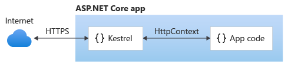
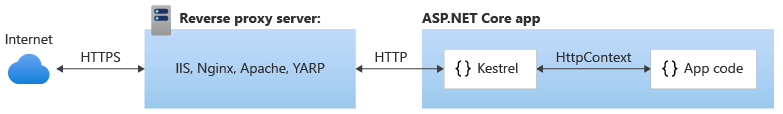

# ack 프로그램

ack 프로그램은 ASP.NET Core 앱의 In-Process HTTP 서버 구현을 사용하여 실행되는 Kestrel 이라는 이름의 웹 서버 프로그램입니다. ack 프로그램은 다음과 같은 기능을 제공합니다.

* 멀티 플랫폼: Windows, Linux 및 macOS에서 실행되는 플랫폼 간 웹 서버입니다.
* 고성능: 많은 수의 동시 연결을 효율적으로 처리하도록 최적화되어 있습니다.
* 경량: 컨테이너 및 에지 디바이스와 같이 리소스가 제한된 환경에서 실행되도록 최적화되었습니다.
* 보안 강화: HTTPS를 지원하고 웹 서버 취약성에 대해 강화됩니다.
* 광범위한 프로토콜 지원: HTTP/1.1, HTTP/2 및 HTTP/3, WebSocket 등등 일반적이면서도 최신 웹 프로토콜을 지원합니다.
* 확장성: 사용자 지정 모듈 운영이 가능한 구성, 미들웨어 기능을 제공합니다.
* 성능 진단: 로깅 및 메트릭과 같은 기본 성능 진단 기능을 제공합니다.

HandStack 에서 제공되는 dbclient, function, logger, repository, transact, wwwroot 과 같은 모듈은 ack 프로그램 위에서 동작합니다. 이러한 모듈은 각각의 기능을 제공하며, 이러한 모듈을 조합하여 최적의 화면과 기능을 구성합니다.

Kestrel 서버 프로그램은 크게 2가지로 웹 서비스를 호스팅 합니다.

## 네트워크의 요청을 직접 처리하는 에지 서버로 단독 사용



## IIS(인터넷 정보 서비스), Nginx 또는 Apache 같은 역방향 프록시 서버와 함께 사용



## 시작 완료 로그

`ack`와 `rdy`는 수신 시작 후 Serilog 시작 로그 건수(경고·오류 및 치명 오류), 실제 수신 주소와 와일드카드 수신의 로컬·네트워크 접속 후보를 기록합니다. 로거 구성 전 콘솔 출력과 별도 로깅 공급자의 이벤트는 건수에 포함되지 않으며, 시작 요약 이후에도 로그가 발생할 수 있습니다. 네트워크 접속 가능 여부는 방화벽과 네트워크 설정에 따라 달라집니다.

`AppSettings:UseForwardProxy`가 켜져 있으면 설정된 `ForwardProxyIP` 목록도 표시합니다. 이는 접속 주소가 아니라 신뢰할 프록시 IP 또는 네트워크입니다. 적용된 `WithOrigins`와 `WithOnlyIPs` 목록은 값이 있을 때만 표시하며, 시작 시점의 스냅샷입니다.

## 모듈 DLL 로딩

`ack`는 `AppSettings:LoadModules` 또는 `--modules`로 선택한 모듈의 의존성 탐색 경로를 등록한 후, 각 모듈의 `<ModuleID>.dll`을 먼저 로드합니다. `IsBundledWithHost=true`인 모듈은 호스트 실행 디렉터리의 DLL을 사용합니다.

의존 관리 DLL은 실제 참조 또는 `Assembly.Load` 요청 시 로드합니다. .NET의 기본 호스트·프레임워크 탐색이 먼저 동작하고, 해결되지 않은 요청은 선택된 모듈의 루트에서 찾습니다. 위성 리소스는 문화권 하위 폴더를 확인합니다. 그래도 찾지 못하면 모듈별로 한 번 파일 경로 색인을 생성하여 기존 하위 폴더 배치를 지원합니다. 색인에 있는 DLL 전체를 미리 로드하지는 않습니다.

`LoadPassAssemblyPath`의 개별 파일 및 `/**` 제외 규칙과 `runtimes` 디렉터리의 관리 DLL 탐색 제외를 유지하며, 호환 색인을 만들 때 디렉터리 링크·정션은 따라가지 않습니다. 네이티브 DLL은 이 관리 DLL 로더가 직접 로드하지 않습니다. 모듈들은 `AssemblyLoadContext.Default`를 공유하므로 동일한 이름의 의존 라이브러리는 호환 가능한 버전으로 배포해야 합니다.

DLL 추가·교체 및 로딩 설정 변경에는 프로세스 재시작이 필요합니다. 지연 로딩되는 의존 DLL의 누락은 해당 기능을 처음 실행할 때 발견될 수 있으므로 `/checkip`와 함께 실제 사용하는 모듈 API 및 동적 C# 함수를 검증합니다. 이 최적화는 `ack`에 적용되며 `rdy`의 로딩 방식은 별도로 유지됩니다.

사용자 정의 모듈이 `AppDomain.CurrentDomain.GetAssemblies()` 또는 `Reflector.GetTypeFromName()`으로 참조되지 않은 DLL의 타입을 찾는다면, 먼저 `Assembly.Load("어셈블리이름")`으로 해당 DLL을 명시적으로 로드합니다. 모듈 폴더에 배치한 모든 DLL이 자동으로 선행 로드되지는 않습니다.

## 정적 파일 경로 캐시

`ack`와 `rdy`의 호스트 정적 루트 및 `wwwroot` 모듈의 `WWWRootBasePath`는 공통 미들웨어로 마지막 파일명 또는 마지막 디렉터리명의 대소문자를 보정합니다. 상위 디렉터리의 대소문자는 파일 시스템 규칙을 따르며, 확장자 없는 정적 파일도 지원합니다.

- GET/HEAD 요청에 적용합니다. `/api/` 세그먼트가 있거나 `/api`로 끝나는 경로, 이미 선택된 동적 엔드포인트, `/`로 끝나는 경로는 디렉터리를 탐색하지 않습니다. API 경로 비교는 대소문자를 구분하지 않습니다.
- 실제 경로 매핑과 미존재 결과를 인스턴스당 최대 4,096개, 항목당 최대 10분간 저장합니다.
- 파일 생성·수정·삭제·이름 변경을 감지하면 해당 정적 루트의 캐시를 무효화합니다. 변경 알림이 누락돼도 만료 후 다음 요청에서 다시 조회합니다.
- 파일 내용, HTTP 캐시 헤더와 IP 접근 제어는 기존 정적 파일 파이프라인에서 처리하며, 호스트 종료 시 경로 캐시와 감시 리소스를 해제합니다.

네트워크 공유나 컨테이너에서 파일 변경 알림이 불안정하면 `DOTNET_USE_POLLING_FILE_WATCHER=1`을 설정하고 재시작할 수 있습니다. 폴링에는 반영 지연이 있으므로 운영 파일 시스템에서 확인합니다. [파일 변경 감시 설명](https://learn.microsoft.com/aspnet/core/fundamentals/file-providers?view=aspnetcore-10.0#watch-for-changes)

## Referrer Policy 기본 동작

`ack`와 `rdy`는 보안 헤더 기능이 활성화되어 있어도 `Referrer-Policy` 응답 헤더를 기본으로 추가하지 않습니다.
공용 JavaScript의 fetch 요청도 `referrerPolicy` 기본 옵션을 지정하지 않습니다. 페이지, 프록시 또는 개별
요청에서 별도 정책을 지정하지 않으면 현대 브라우저의 기본값인 `strict-origin-when-cross-origin`이 적용됩니다.
이 정책은 동일 출처 요청에 페이지 URL의 경로와 쿼리를 포함하고, 다른 출처 요청에는 출처만 전달하며,
HTTPS에서 일반 HTTP로 보내는 요청에는 `Referer`를 생략합니다. 민감한 페이지는 별도로 `no-referrer`를
지정할 수 있으며, URL에 토큰이나 개인정보를 넣지 않습니다.

## appsettings.json 파일 내용

```json
{
    "AppSettings": {
        "HostAccessID": "HANDSTACK_HOSTACCESSID",
        "SystemID": "HANDSTACK",
        "ApplicationID": "HDS",
        "ProgramName": "ack",
        "HostName": "HOSTNAME",
        "InstallType": "L",
        "BusinessServerUrl": "http://localhost:8421/transact/api/transaction/execute",
        "FindGlobalIDServer": "",
        "ForwardProxyIP": [],
        "IsAutoUpdate": false,
        "IsConfigurationWatching": false,
        "IsExceptionDetailText": true,
        "IsEnabledDevAutoSignIn": false,
        "ContractRequestPath": "view",
        "IsModulePurgeContract": true,
        "IsEnabledCSP": false,
        "LoadModuleBasePath": "../modules",
        "LoadModules": [
            "wwwroot",
            "transact",
            "dbclient",
            "graphclient",
            "function",
            "command",
            "prompter",
            "repository",
            "logger",
            "forwarder"
        ],
        "ModuleConfigurationUrl": [
        ],
        "RunningEnvironment": "D",
        "UseResponseComression": false,
        "UseForwardProxy": false,
        "UseSameIPProxy": false,
        "Security": {
            "EnableSecurityHeaders": true,
            "EnablePublicCorsPolicy": true,
            "ExposeSecretValues": false,
            "WarnOnWildcardAllowClientIP": true,
            "MaxContractSyncFileBytes": 10485760,
            "RequestOriginApiAccess": {
                "Enabled": true,
                "AllowLoopback": true,
                "IsPortComparison": false,
                "HeaderName": "X-Api-Key",
                "AllowedReferers": [],
                "ApiKeys": []
            }
        },
        "WithOrigins": [
            "http://127.0.0.1",
            "http://127.0.0.1:8421",
            "http://localhost",
            "http://localhost:8421"
        ],
        "WithOnlyIPs": [],
        "SessionState": {
            "IsSession": true,
            "SessionCookieName": "HandStack.Session",
            "CacheType": "Memory",
            "MySqlConnectionString": "Server=127.0.0.1;Port=3306;Database=HandStack_Cache;Uid=handstack;Pwd=handstack~!@34;PersistSecurityInfo=True;SslMode=none;Charset=utf8;Allow User Variables=True;",
            "MySqlSchemaName": "HandStack_Cache",
            "MySqlTableName": "SessionData",
            "SqlServerConnectionString": "Data Source=127.0.0.1;TrustServerCertificate=True;Initial Catalog=HandStack_Cache;User ID=handstack;Password=handstack~!@34;Connection Timeout=0;",
            "SqlServerSchemaName": "dbo",
            "SqlServerTableName": "SessionData"
        },
        "CookiePrefixName": "HandStack",
        "CookieSameSite": "Lax",
        "UserSignExpire": -1
    },
    "Serilog": {
        "Using": [ "Serilog.Sinks.File", "Serilog.Sinks.Console" ],
        "MinimumLevel": {
            "Default": "Information",
            "Override": {
                "Microsoft": "Error",
                "System": "Error"
            }
        },
        "Enrich": [ "FromLogContext" ],
        "WriteTo": [
            {
                "Name": "Console",
                "Args": {
                    "outputTemplate": "[{Timestamp:HH:mm:ss} {Level:u3}] {Message:lj}{NewLine}{Exception}"
                }
            },
            {
                "Name": "File",
                "Args": {
                    "path": "../log/app.log",
                    "rollingInterval": "Day",
                    "rollOnFileSizeLimit": true,
                    "buffered": true,
                    "fileSizeLimitBytes": 104857600,
                    "flushToDiskInterval": "00:00:05",
                    "outputTemplate": "[{Timestamp:HH:mm:ss} {Level:u3}] {Message:lj}{NewLine}{Exception}"
                }
            }
        ]
    },
    "Kestrel": {
        "DisableStringReuse": true,
        "Limits": {
            "MaxConcurrentConnections": null,
            "MaxConcurrentUpgradedConnections": null,
            "MaxRequestBodySize": 104857600,
            "KeepAliveTimeout": "00:02:00"
        }
    }
}
```

## 실행 옵션

```text
ack --port=8421 --modules=wwwroot,transact,dbclient,function
```

| 옵션 | 설명 | 기본값 |
|---|---|---|
| `--port` | 수신 포트 | `8421` |
| `--modules` | 시작할 모듈을 쉼표로 지정합니다. 지정하면 `appsettings.json`의 `AppSettings:LoadModules`를 합치지 않고 **대체**합니다 | 설정의 `LoadModules` |
| `--appsettings`, `--key` | 두 옵션을 함께 주면 `--appsettings` 값을 `--key`로 AES 복호화한 JSON을 마지막 설정으로 추가하고, 이때 `appsettings.{ACK_ENVIRONMENT}.json`은 읽지 않습니다. `handstack configuration`이 이 방식으로 환경별 설정을 적용합니다 | |
| `--pname` | 관리 목적으로 붙이는 프로세스 이름 | |
| `--env` | `KEY=VALUE` 줄로 된 문자열을 환경 변수로 읽습니다 | |
| `--showenv` | 시작할 때 적용되는 환경 설정을 출력합니다 | `false` |
| `--debug`, `--delay` | 시작 전에 디버거가 연결될 시간(밀리초)을 기다립니다 | `--delay` 10000 |

개발 중에는 필요한 모듈만 켜면 시작이 빠르고 원인을 나누기 쉽습니다. 화면 개발은 `wwwroot,transact,dbclient`에 `function`, `prompter` 등 쓰는 모듈을 더합니다.

## 설정을 읽는 순서

`ack`는 다음 순서로 설정을 쌓고 **뒤에 읽은 값이 앞의 값을 덮어씁니다**(소스의 `ConfigurationBuilder` 순서).

1. `appsettings.json`
2. OS별 설정 파일([OS별 설정 파일](#os별-설정-파일))
3. 환경 변수(`AppSettings__키=값`)
4. `--key`와 `--appsettings`로 받은 복호화 설정. 없으면 `ACK_ENVIRONMENT` 환경 변수 값에 해당하는 `appsettings.{ACK_ENVIRONMENT}.json`(파일이 있을 때만)

따라서 같은 키라면 `appsettings.{ACK_ENVIRONMENT}.json`이 환경 변수보다 우선합니다. 모듈은 `module.json` 뒤에 `module.{os}.json`을 적용합니다. `RunningEnvironment`는 `D`, `S`, `P`만 지원합니다.

## 실시간 반영과 재시작이 필요한 설정

`AppSettings:IsConfigurationWatching`이 `true`이면 파일 변경을 감시해 아래 `appsettings.json` 키를 **재시작 없이** 반영합니다. 새 값이 유효할 때만 교체하고 오류면 이전 설정을 유지합니다. 로드된 모듈의 `module.json`(데이터 원본 `DataSource`, `LLMSource`, `FunctionSource`, `GraphDataSource` 포함)도 같은 방식으로 반영됩니다.

- 실시간 반영: `BusinessServerUrl`, `FindGlobalIDServer`, `HostAccessID`, `IsExceptionDetailText`, `ContractRequestPath`, `CookiePrefixName`, `UserSignExpire`, `StaticFileCacheMaxAge`, `WithOnlyIPs`, `IsPermissionRoles`, `PermissionRoles`
- **재시작 필요**: `UseContractSync`, `UseHttpLogging`, `UseForwardProxy`, `UseResponseComression`, `InstallType`, `ApplicationID`, `ProgramName`, `RunningEnvironment`, `HostName`, `SystemID`, `IsConfigurationWatching`, `IsSwaggerUI`, `IsModulePurgeContract`, `SessionState`, `ProxyBasePath`, `IsAntiforgeryToken`, `LoadModuleBasePath`, `LoadModules`, `LoadModuleLicenses`, `ModuleConfigurationUrl`, `DiscoveryApiServerUrl`, `ComressionEnableForHttps`, `ComressionMimeTypes`, `ForwardProxyIP`, `UseSameIPProxy`, `AuthenticationLoginPath`, `AuthenticationLogoutPath`, `SqidsAlphabet`, `LicenseKey`, `LicenseSignature`, `WithOrigins`

그 밖의 변경(DLL 추가·교체, 새 모듈 추가·삭제, DI·미들웨어, OS별 파일 변경, 환경 변수와 `appsettings.{환경}.json` 변경)도 재시작이 필요합니다. 철자 오류(`Comression`)는 소스의 설정 키 이름 그대로입니다.

:::caution HostAccessID를 실시간 반영할 때
시작할 때는 `HostAccessID`를 SHA-256 해시로 바꿔 보관하지만, 실시간 반영 경로(`RuntimeConfigurationService`)는 설정 값을 그대로 대입합니다. `HostAccessID`를 감시로 바꾼 뒤에는 관리 엔드포인트가 기대하는 값이 해시에서 원문으로 달라질 수 있으니, 바꾼 직후에는 호출이 거부되는지 확인하고 필요하면 재시작하세요(확인 필요).
:::

## 관리 엔드포인트

`ack`가 모듈과 별개로 제공하는 엔드포인트입니다. `hostAccessID`가 필요한 항목은 아래 규칙을 따릅니다.

| 경로 | 메서드 | 인증 | 설명 |
|---|---|---|---|
| `/checkip` | GET | 없음 | 호출자 IP를 텍스트로 돌려줍니다. 헬스체크와 프록시 뒤 IP 확인에 씁니다 |
| `/diagnostics` | GET | `hostAccessID` | 프로세스·런타임·Kestrel 진단 JSON. 실패하면 `401` |
| `/metrics` | GET | `hostAccessID` | Prometheus 형식 요청 지표. 실패하면 `401` |
| `/globalconfiguration` | GET | `hostAccessID` | 적용 중인 전역 설정 스냅샷과 재시작 필요 키. 실패하면 `401` (오타 경로 `/globalconfigration`도 같은 동작) |
| `/globalconfiguration/apply` | POST | `hostAccessID` | 실시간 반영 가능한 전역 설정을 적용. 오류가 있으면 `400` |
| `/moduleconfiguration/mediatr` | GET | `hostAccessID` | 모듈별 `EventAction`·`SubscribeAction`(MediatR 발행·구독) 설정 조회 |
| `/moduleconfiguration/mediatr/{moduleID}/apply` | POST | `hostAccessID` | 모듈의 `EventAction`·`SubscribeAction` 설정 적용. 모듈이 없으면 `404`, 오류가 있으면 `400` |
| `/manifest` | GET | `launch=true`일 때 `hostAccessID` | 업데이트 매니페스트. `launch=true`는 `AppSettings:IsAutoUpdate`가 `true`일 때만 updater를 띄우고, `false`(기본)이면 `403` |
| `/license-keys` | GET | `hostAccessID` | 로드된 모듈 라이선스 키 이름 목록 |
| `/stop` | GET | `hostAccessID` | 프로세스를 종료합니다. 인증에 실패해도 응답이 `200`에 본문 없음이므로 종료 여부는 프로세스로 확인하세요 |
| `/contractsync` | POST | `hostAccessID` | [계약 파일 동기화](#계약-파일-동기화) |
| `/secrets` | GET·POST·DELETE | 클라이언트 정보 헤더(`HandStack-MachineID`, `HandStack-IP` 등) | 시크릿 저장소 API. 세부 규칙은 확인 필요 |

**`hostAccessID` 전달**: 쿼리 문자열, 폼 필드, 경로 값, 헤더 순으로 찾습니다. 값은 `AppSettings:HostAccessID` **원문이 아니라 그 SHA-256 소문자 16진 해시**입니다. 해시가 맞지 않으면 `401`입니다.

```powershell
curl "http://localhost:8421/diagnostics?hostAccessID=<SHA-256 소문자 16진 해시>"
```

Docker에서는 설정한 `HostAccessID` 값을 해시합니다. 기본값(`HANDSTACK_HOSTACCESSID`)을 그대로 둔 Docker가 아닌 환경에서는 비교 값이 환경에 따라 달라질 수 있어 문서화하지 않습니다. 운영에서는 고유한 값을 설정하세요.

## 계약 복사와 삭제

모듈의 `Contracts` 폴더는 `ack`가 시작할 때 공유 계약 폴더(`contracts`)로 복사될 수 있습니다. 모듈 설정(`module.json`)의 다음 키가 제어합니다.

| 키 | 기본값 | 동작 |
|---|---|---|
| `IsCopyContract` | `true` | 시작할 때 모듈의 `Contracts`를 공유 계약 폴더로 복사합니다 |
| `IsPurgeContract` | `false` | 시작할 때 모듈 계약 경로의 파일과 같은 위치에 복사되어 있던 사본을 공유 계약 폴더에서 삭제해 중복 계약을 막습니다. 세부 조건은 소스 확인 필요 |

`appsettings.json`의 `AppSettings:IsModulePurgeContract`(기본 `true`)는 전역 설정이며 재시작이 필요합니다. 수정이 반영되지 않으면 서버가 읽는 경로(원본인지 복사본인지), 파일 감시 또는 `refresh`, 같은 ID의 중복 계약, 재시작 순서로 확인하세요([수정했는데 예전 동작이 나옴](/docs/guides/문제-해결#수정했는데-예전-동작이-나옴)).

## OS별 설정 파일

실행 중인 OS에 맞는 설정 파일이 있으면 기본 설정 위에 덮어씁니다. 같은 키를 Windows, Ubuntu, macOS에서 다르게 써야 할 때(경로, 인증서, 외부 주소 등) 사용합니다. 파일이 없으면 기본 설정을 그대로 사용합니다.

| 대상 | 기본 파일 | OS별 파일 (실행 OS의 파일 하나만 사용) |
| ---- | --------- | -------------------------------------- |
| 호스트(`ack`, `rdy`) | `appsettings.json` | `appsettings.windows.json`, `appsettings.linux.json`, `appsettings.macos.json` |
| 모듈 | `module.json` | 같은 폴더의 `module.windows.json`, `module.linux.json`, `module.macos.json` |

- OS별 파일은 프로그램이 시작할 때 **한 번만** 읽습니다. 실행 중에 파일을 바꾸거나 새로 만들어도 반영하지 않으며 재시작이 필요합니다.
- 객체는 키 단위로 병합하고, 값과 **배열은 OS별 파일의 값으로 교체**합니다. 배열은 인덱스별 병합이 아니라 통째로 바뀌므로 `LoadModules`, `WithOrigins`, `Serilog:WriteTo`, `ContractBasePath`, `DataSource` 같은 배열은 OS별 파일에 전체 항목을 적습니다. 키 이름의 대소문자는 구분하지 않고, `null`도 덮어씁니다.
- 호스트는 `appsettings.json` 바로 뒤에 적용하므로 `appsettings.{ACK_ENVIRONMENT}.json`, 환경 변수, 명령행 값이 있으면 그 값이 우선합니다. `ack`와 `rdy`는 설정을 두 번(시작 설정, 호스트 설정) 만들며 둘 다 같은 규칙을 적용합니다.
- OS별 파일이 있는 호스트는 `appsettings.json`의 파일 변경 자동 다시 읽기(호스트 구성)가 동작하지 않습니다. `AppSettings:IsConfigurationWatching`과 모듈 설정 감시는 병합된 값으로 비교하고 반영하므로, OS별 파일이 덮어쓴 키는 기본 파일에서 값을 바꿔도 OS별 파일의 값이 유지됩니다.
- 런타임 설정 저장과 `agent`의 설정 편집은 기본 파일(`appsettings.json`, `module.json`)에만 기록하고 OS별 파일은 수정하지 않습니다. OS별 파일이 덮어쓰는 키는 저장한 값과 실제 적용 값이 다를 수 있습니다.
- 원격 설정(`ModuleConfigurationUrl`로 받는 `module.json`)에는 적용하지 않습니다.
- OS별 파일의 JSON 형식이 잘못되면 시작할 때 오류로 중단합니다.
- 빌드 출력에는 기본 파일과 같은 규칙으로 포함되고, `rdy` 게시에서는 정적 모듈의 `module.{os}.json`을 `module.json`과 같이 제외합니다. `rdy/task.ps1`의 포트 일괄 변경은 OS별 파일도 함께 치환합니다.
- 현재 `agent`, `deploy`, `forbes`는 `HandStack.Web`을 참조하지 않아 적용하지 않았습니다.

예) Ubuntu에서만 로그 경로와 로드 모듈을 바꾸는 `appsettings.linux.json`

```json
{
    "AppSettings": {
        "LoadModules": ["wwwroot", "transact", "dbclient"]
    },
    "Serilog": {
        "WriteTo": [
            { "Name": "Console" },
            { "Name": "File", "Args": { "path": "/var/log/handstack/app.log", "rollingInterval": "Day" } }
        ]
    }
}
```

예) Ubuntu에서만 계약 경로를 바꾸는 `module.linux.json` (배열이므로 `ContractBasePath` 항목 전체를 적습니다)

```json
{
    "ModuleConfig": {
        "ContractBasePath": ["/var/handstack/contracts/dbclient"]
    }
}
```

## 계약 파일 동기화

`AppSettings:UseContractSync`를 `true`로 설정하면 `ack`와 `rdy`의 `POST /contractsync`에서 `handsonapp`이 전송한 계약 및 화면 파일을 동기화할 수 있습니다. 요청은 `hostAccessID` 헤더와 `moduleID`, `contractType`, `destFilePath`, `changeType`, `file` 폼 필드를 사용합니다. 삭제 요청은 `file`을 생략합니다.

허용되는 `contractType`은 `dbclient`, `graphclient`, `function`, `transact`, `command`, `prompter`, `repository`, `wwwroot`입니다. 계약 파일은 `%HANDSTACK_HOME%/modules/<moduleID>/Contracts/<contractType>`와 `%HANDSTACK_HOME%/contracts/<contractType>`에 반영되며, `wwwroot`는 `%HANDSTACK_HOME%/modules/<moduleID>/wwwroot/<moduleID>`에 반영됩니다.

## 개발용 테스트 계정 자동 로그인

`AppSettings:IsEnabledDevAutoSignIn`(기본값 `false`)을 `true`로 설정하고 `RunningEnvironment`가 `D`(개발)인 경우에만, `wwwroot` 모듈의 `GET /wwwroot/api/dev-account/sign-in`이 `module.json`의 `ModuleConfig.DevAutoSignIn`(`UserNo`/`UserID`/`UserName`/`Email`/`Roles`)에 지정한 고정 계정으로 이메일 서명 검증 없이 로그인 쿠키를 발급합니다. 두 조건 중 하나라도 충족하지 않으면 `404 Not Found`를 반환하므로, 운영·스테이징 설정에서는 `IsEnabledDevAutoSignIn`을 켜지 않아야 합니다.

## Serilog 파일 로그 설정

Serilog에 대한 자세한 정보는 다음 웹사이트에서 확인하실 수 있습니다:

### Serilog.Settings.Configuration

Serilog 설정을 Microsoft.Extensions.Configuration에서 읽는 방법에 대해 설명하고 있습니다. 기본적으로, 설정은 Serilog 섹션에서 읽습니다. https://github.com/serilog/serilog-settings-configuration

### AppSettings · serilog/serilog Wiki

App.config 및 Web.config 파일에서 appSettings 기반 구성 구문을 사용하여 최소 수준을 설정하고, 추가 속성으로 이벤트를 풍부하게 하며, 로그 출력을 제어하는 방법에 대해 설명하고 있습니다. https://github.com/serilog/serilog/wiki/AppSettings

### Serilog 공식 문서

Serilog에 대한 설치, 기본 구성, 로그 이벤트 작성, 구조화된 데이터, 제공된 싱크, 디버깅 및 진단에 대한 정보와 조언을 제공합니다. https://serilog.net/

## IpRateLimit 파일 로그 설정

IpRateLimitMiddleware - GitHub: 이 페이지는 IpRateLimitMiddleware에 대한 설명과 사용 방법을 제공합니다. 또한, appsettings.json에서 일반 구성과 IP 규칙을 로드하는 방법에 대해 설명하고 있습니다.

https://github.com/stefanprodan/AspNetCoreRateLimit/wiki/IpRateLimitMiddleware

## Kestrel 서버 설정

Kestrel에 대한 자세한 정보는 다음 웹사이트에서 확인하실 수 있습니다:

Kestrel 웹 서버의 엔드포인트를 구성하는 방법에 대해 설명하고 있습니다. 주소와 프로토콜의 조합으로 엔드포인트를 정의하며, 이를 통해 들어오는 요청을 적절한 미들웨어로 라우팅합니다.

https://learn.microsoft.com/ko-kr/aspnet/core/fundamentals/servers/kestrel/endpoints?view=aspnetcore-10.0

Kestrel 웹 서버의 옵션을 구성하는 방법에 대해 설명하고 있습니다. 일반적인 제한, HTTP/2 제한, 기타 옵션 등에 대한 정보를 제공합니다.

https://learn.microsoft.com/ko-kr/aspnet/core/fundamentals/servers/kestrel/options?view=aspnetcore-10.0

Kestrel이 실행 시간에 구성 변경을 감지하는 방법에 대해 설명하고 있습니다.

https://learn.microsoft.com/ko-kr/aspnet/core/fundamentals/servers/kestrel?view=aspnetcore-10.0

Kestrel 웹 서버에 대한 전반적인 정보를 제공합니다.

https://learn.microsoft.com/ko-kr/dotnet/core/compatibility/aspnet-core/5.0/kestrel-configuration-changes-at-run-time-detected-by-default
